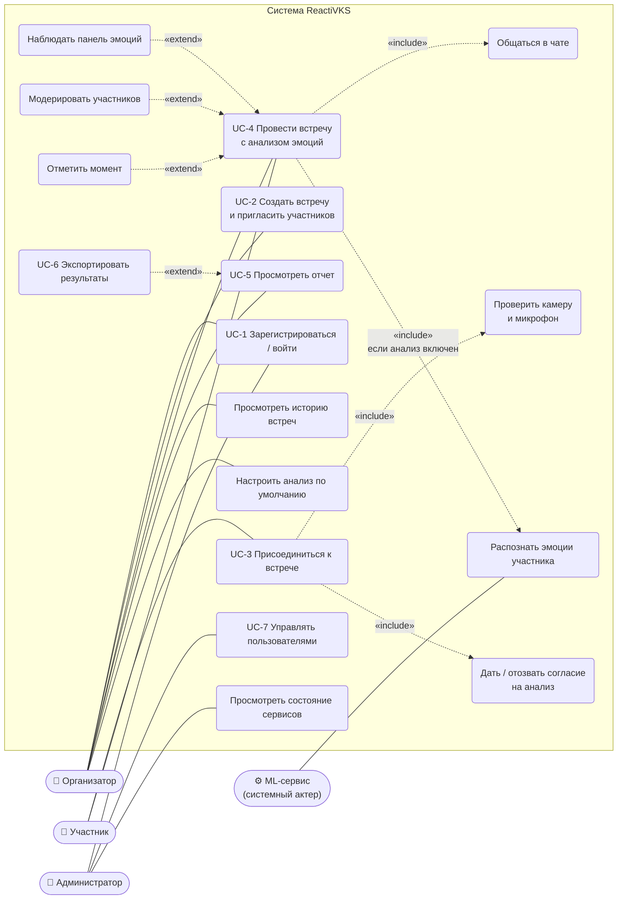
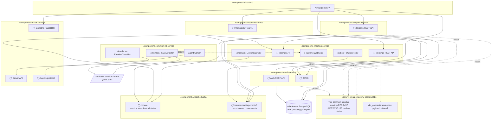
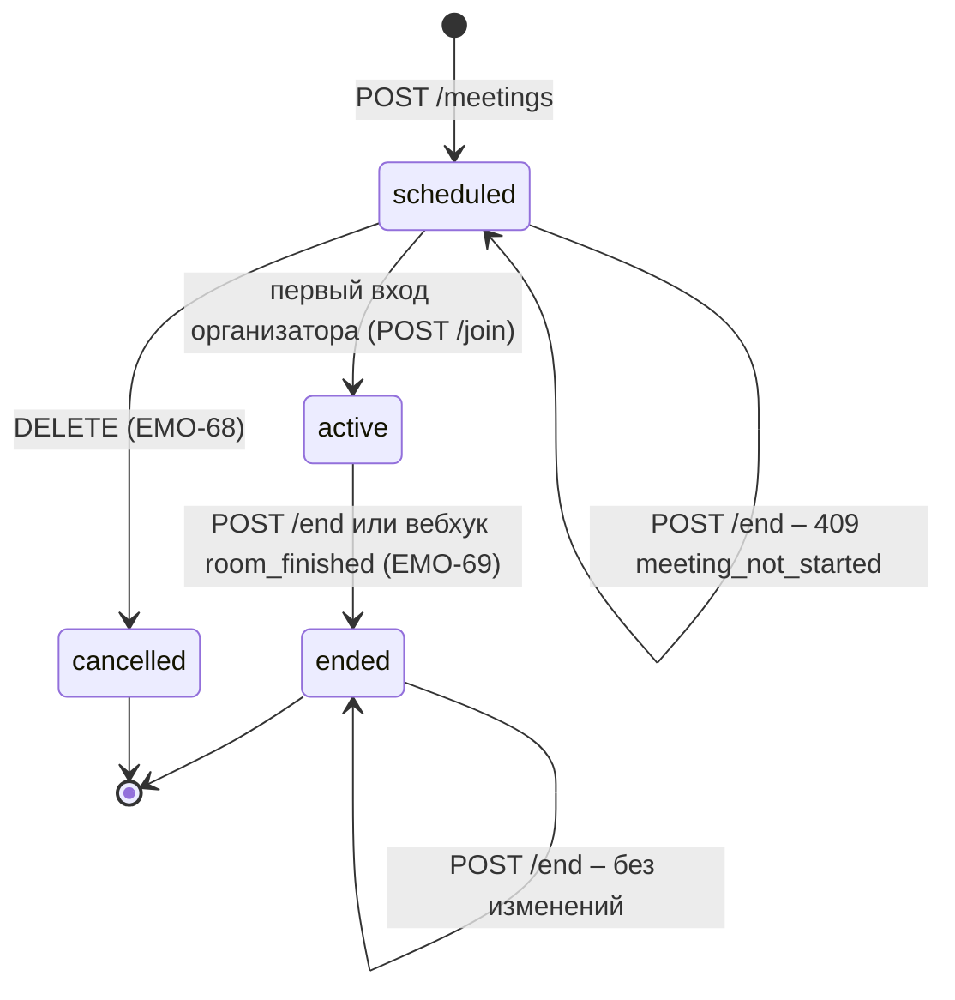
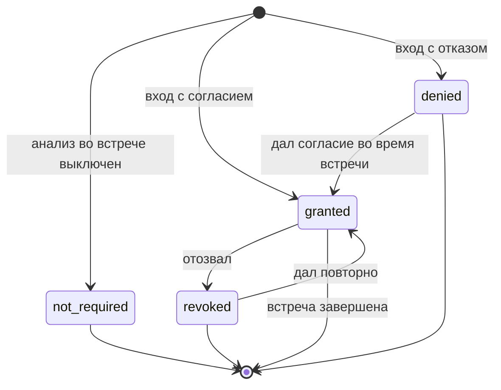
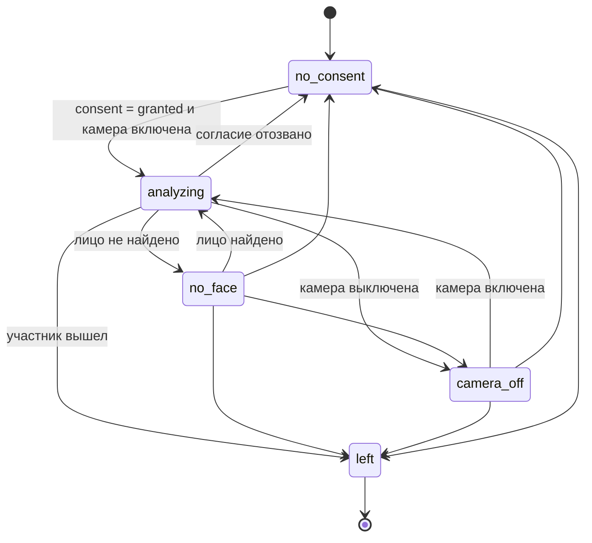
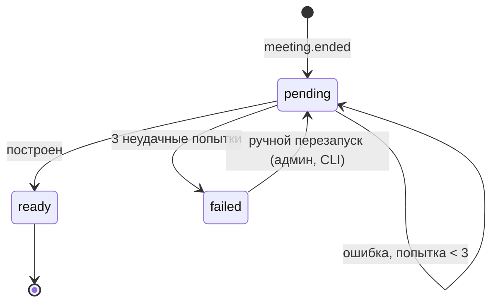

# 9. UML-представления

Сводка диаграмм, которые концепция (п. 8.2) требует для проектирования: прецедентов, компонентов,
последовательности, развертывания; дополнительно – классы предметной области и состояния.
Диаграммы выполнены в Mermaid; нотация UML передана средствами Mermaid (актеры – овалы, прецеденты – скругленные
блоки, интерфейсы компонентов – кружки «◯»).

| Вид UML | Где |
|---|---|
| Прецедентов | [9.1](#91-диаграмма-прецедентов) |
| Компонентов | [9.2](#92-диаграмма-компонентов) |
| Классов (предметная область) | [9.3](#93-диаграмма-классов-предметной-области) |
| Состояний | [9.4](#94-диаграммы-состояний), жизненный цикл встречи – [04-data-model.md](04-data-model.md#жизненный-цикл-встречи) |
| Последовательности | [03-scenarios.md](03-scenarios.md) (UC-1…UC-7), [backend/conventions.md](../backend/conventions.md#6-публикация-событий-transactional-outbox) (outbox) |
| Развертывания | [06-deployment.md](06-deployment.md#61-диаграмма-развертывания) |

## 9.1 Диаграмма прецедентов

Организатор при входе во встречу с анализом также проходит «Дать согласие» (как любой участник, см. открытый
вопрос 4 в [08-implementation-plan.md](08-implementation-plan.md#84-открытые-вопросы)).

## 9.2 Диаграмма компонентов

Предоставляемые интерфейсы обозначены «◯ имя», требуемые – стрелкой к интерфейсу. Библиотеки `vks_common` (шасси)
и `vks_contracts` (контракты событий) входят в каждый Python-сервис; события сервисов с БД идут в Kafka только
через outbox – таблицу своей схемы и фоновый `OutboxRelay` ([ADR-011](../adr/ADR-011-transactional-outbox.md)).

## 9.3 Диаграмма классов предметной области

Доменные сущности сервисов (слой `domain/`); сервисы не разделяют классы – связи между контекстами идут через
идентификаторы и события. Сущности неизменяемы: переход состояния возвращает новый объект. Для auth и meeting
диаграмма повторяет реализованный код; операции следующих задач помечены «план» в таблице под диаграммой.

```mermaid
classDiagram
    direction LR

    namespace auth {
        class User {
            <<entity>>
            +UserId id
            +str email
            +str display_name
            +Role role
            +UserStatus status
            +ensure_can_sign_in()
            +renamed(display_name) User
        }
        class RefreshToken {
            <<entity>>
            +RefreshTokenId id
            +SessionFamilyId family_id
            +bytes token_hash
            +datetime expires_at
            +datetime revoked_at
            +RefreshTokenId replaced_by
            +is_expired(now) bool
            +rotated(successor, now) RefreshToken
        }
        class TokenSigner {
            <<interface>>
            +sign(claims) str
            +published_keys() list
        }
        class PasswordHasher {
            <<interface>>
            +hash(password) str
            +verify(password, hash) bool
        }
    }

    namespace meeting {
        class Meeting {
            <<entity>>
            +MeetingId id
            +UserId owner_id
            +str owner_name
            +str title
            +str invite_code
            +MeetingStatus status
            +bool analysis_enabled
            +int analysis_fps
            +schedule(organizer, title, …) Meeting
            +started(now) Meeting
            +ensure_open_for_guests()
            +ended(now, reason) Meeting
        }
        class AnalysisDefaults {
            <<value object>>
            +bool enabled
            +int fps
        }
        class Participant {
            <<entity>>
            +ParticipantId id
            +MeetingId meeting_id
            +UserId user_id
            +str display_name
            +ParticipantRole role
            +ConsentState consent_state
            +bool is_removed
            +livekit_identity str
            +with_consent(state) Participant
        }
        class ConsentNotice {
            <<value object>>
            +str version
            +str text_md
        }
        class ConsentRecord {
            <<immutable>>
            +ConsentState decision
            +str notice_version
            +str display_name
            +str meeting_title
            +datetime decided_at
        }
        class LiveKitGateway {
            <<interface>>
            +public_url str
            +ensure_room(room)
            +delete_room(room)
            +issue_token(RoomAccess) str
        }
        class RoomAccess {
            <<value object>>
            +str room
            +str identity
            +str name
            +Mapping attributes
        }
    }

    namespace analytics {
        class SecondBucket {
            +UUID meeting_id
            +UUID participant_id
            +datetime ts
            +int samples
            +int face_samples
            +add(sample)
            +mean() EmotionVector
        }
        class EmotionVector {
            <<value object>>
            +float[7] p
            +dominant() EmotionLabel
            +valence() float
            +negative_share() float
        }
        class Report {
            +UUID meeting_id
            +ReportStatus status
            +Summary summary
            +build(series, projection)
        }
        class Marker {
            +UUID id
            +datetime ts
            +MarkerKind kind
            +str label
        }
        class KeyMomentDetector {
            +float threshold
            +detect(series) Marker[]
        }
    }

    User "1" --> "*" RefreshToken
    Meeting ..> AnalysisDefaults : параметры по умолчанию
    Meeting "1" *-- "*" Participant
    Participant "1" --> "*" ConsentRecord
    ConsentRecord ..> ConsentNotice : версия текста
    LiveKitGateway ..> RoomAccess
    RoomAccess ..> Participant : room_access(meeting, participant)
    SecondBucket ..> EmotionVector
    Report "1" o-- "*" Marker
    KeyMomentDetector ..> Marker : создает
```

| Класс | Реализовано | План |
|---|---|---|
| `User`, `RefreshToken`, `TokenSigner`, `PasswordHasher` | Вход, ротация refresh-токенов с отзывом семьи, профиль, смена пароля (EMO-33, EMO-67) | `block()`, `unblock()` – администрирование (EMO-67) |
| `Meeting` | Создание, вход организатора (`scheduled → active`), завершение, правила входа гостя (EMO-53) | `cancelled(now)` – `DELETE` (EMO-68), проверка `meeting_full` по онлайн-участникам (EMO-69) |
| `Participant`, `ConsentRecord`, `ConsentNotice` | Регистрация организатора и гостя, решение о согласии и журнал (EMO-53) | `removed()` – модерация (EMO-70), отзыв согласия (EMO-84) |
| `LiveKitGateway` | `CreateRoom`, `DeleteRoom`, токены с атрибутами `vks.*` (EMO-53) | `UpdateParticipant`, `MutePublishedTrack`, `RemoveParticipant`, `CreateDispatch` (EMO-70, EMO-84) |
| analytics | – | EMO-86, EMO-87 |

## 9.4 Диаграммы состояний

### Встреча

Гость входит только в `active`: в `scheduled` – `409 meeting_not_started` (клиент повторяет), в `ended` и
`cancelled` – `409 meeting_ended` / `meeting_cancelled`.

### Согласие участника

### Анализ участника (в ML-сервисе и на панели)

### Отчет

