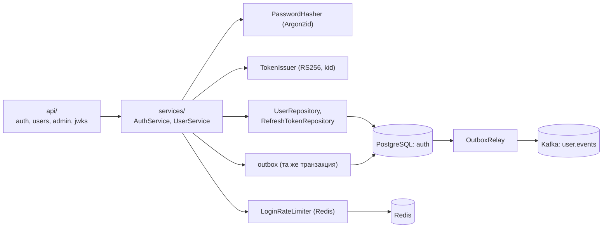
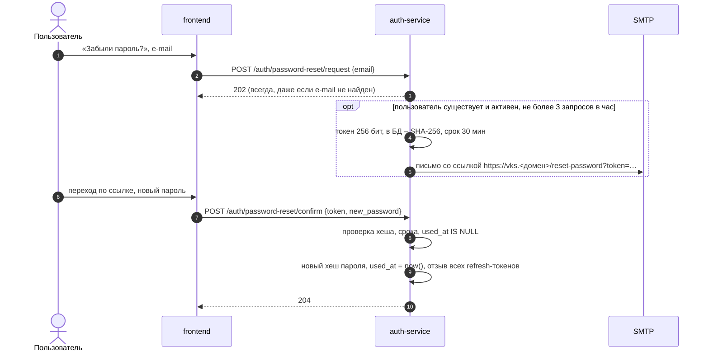

# auth-service

## Назначение

Учетные записи организаторов и администраторов, аутентификация, выпуск JWT, управление пользователями
(администрирование, функция 6.11 в части учетных записей).

## Ответственность

- Регистрация по e-mail и паролю, вход, выход, обновление токенов.
- Выпуск access-токенов JWT RS256 и публикация JWKS.
- Ротация refresh-токенов с обнаружением повторного использования.
- Профиль пользователя (отображаемое имя, смена пароля).
- Администрирование: список пользователей, блокировка/разблокировка, удаление.
- Восстановление пароля по e-mail (дополнительная функция).
- Публикация событий `user.blocked`, `user.unblocked`, `user.deleted` в топик Kafka `user.events` (через outbox).

**Не отвечает** за участников-гостей: их идентификация – в meeting-service.

## Внешний API (через Nginx)

| Метод | Путь | Доступ | Описание |
|---|---|---|---|
| POST | `/api/v1/auth/register` | все | Регистрация (роль `organizer`) |
| POST | `/api/v1/auth/login` | все | Вход → access-токен + refresh-cookie |
| POST | `/api/v1/auth/refresh` | refresh-cookie | Новая пара токенов |
| POST | `/api/v1/auth/logout` | refresh-cookie | Отзыв текущего refresh-токена |
| GET | `/api/v1/auth/.well-known/jwks.json` | все | Публичные ключи |
| GET | `/api/v1/auth/config` | все | Публичные флаги (`registration_enabled`, `password_reset_enabled`) |
| POST | `/api/v1/auth/password-reset/request`, `/confirm` | все | Восстановление пароля (доп.) |
| GET/PATCH | `/api/v1/users/me` | организатор | Профиль |
| POST | `/api/v1/users/me/password` | организатор | Смена пароля |
| GET | `/api/v1/admin/users` | admin | Список, поиск, фильтр по статусу |
| PATCH | `/api/v1/admin/users/{id}` | admin | Блокировка/разблокировка, роль |
| DELETE | `/api/v1/admin/users/{id}` | admin | Удаление учетной записи |

Подробности – [../api/rest-api.md](../api/rest-api.md).

## Внутренние компоненты



## Ключевые правила

- Пароль: 8–128 символов, хотя бы одна буква и одна цифра, без пробелов по краям (правило домена, одно для
  регистрации, смены и восстановления пароля). Хеш Argon2id (`argon2-cffi`), параметры OWASP: 19 МиБ, 2 прохода,
  1 поток – вход укладывается в 100–300 мс и не съедает память контейнера при параллельных входах.
- E-mail хранится в нижнем регистре, уникальность – ограничением `users_email_uk` на `citext`.
- Ответы на неизвестный e-mail и неверный пароль одинаковы (`invalid_credentials`) и по содержанию, и по времени:
  для неизвестного адреса выполняется проверка с фиктивным хешем той же стоимости.
- Заблокированный пользователь получает `403 user_blocked` только при верном пароле; при неверном – обычный
  `invalid_credentials`, блокировка не раскрывается.
- Refresh-токен – 256 случайных бит, в БД – SHA-256. Токены объединены в семью (`family_id`) – цепочку ротаций одного
  входа. Ротация – под блокировкой строки (`SELECT … FOR UPDATE`), поэтому из двух одновременных обменов одного
  токена успешен ровно один. Повторное предъявление уже обмененного токена отзывает всю семью (признак кражи).
- Смена пароля и блокировка отзывают все refresh-токены пользователя.
- Хеширование пароля выполняется в потоке (`asyncio.to_thread`) и вне транзакции БД.

## Ключи подписи

- Текущий ключ – закрытый RSA ≥ 2048 бит из файла `JWT_PRIVATE_KEY_PATH` (Docker secret). В БД ключи не хранятся.
- `kid` – отпечаток публичного ключа по RFC 7638 (SHA-256 канонического JWK, base64url): один и тот же ключ всегда
  получает один и тот же `kid`, перезапуск сервиса не ломает выданные токены.
- Ротация: новый закрытый ключ кладется в `JWT_PRIVATE_KEY_PATH`, публичная часть прежнего – в
  `JWT_PREVIOUS_PUBLIC_KEY_PATH`. JWKS публикует оба ключа, пока не истекут access-токены, подписанные прежним
  (≥ 15 мин), после чего `JWT_PREVIOUS_PUBLIC_KEY_PATH` убирается.
- Ключ для разработки: `uv run python scripts/gen_jwt_key.py` (в `backend/`), файл не коммитится.

## Первый администратор

```bash
vks-auth create-admin --email admin@example.ru --display-name "Администратор"   # пароль запрашивается дважды
echo "$ADMIN_PASSWORD" | vks-auth create-admin --email … --display-name … --password-stdin
```

Создает пользователя с ролью `admin` через тот же сценарий, что и регистрация (политика пароля та же). Если адрес
уже занят, команда завершается с ошибкой и ничего не меняет.

## Конфигурация

| Переменная | По умолчанию | Описание |
|---|---|---|
| `DATABASE_URL` | – (обязательна) | `postgresql+asyncpg://auth_svc:…@postgres:5432/vks` |
| `ENV` | `development` | `development` \| `test` \| `production` |
| `LOG_LEVEL` | `INFO` | Уровень журналов |
| `JWT_PRIVATE_KEY_PATH` | – (обязательна) | Закрытый ключ RS256, PEM |
| `JWT_PREVIOUS_PUBLIC_KEY_PATH` | – | Публичный ключ на время ротации, PEM |
| `JWT_ISSUER`, `JWT_AUDIENCE` | `vks-auth`, `vks` | `iss` и `aud` access-токена |
| `AUTH_ACCESS_TOKEN_TTL_SECONDS` | `900` | Срок access-токена |
| `AUTH_REFRESH_TOKEN_TTL_DAYS` | `30` | Срок refresh-токена и cookie |
| `AUTH_REFRESH_COOKIE_SECURE` | `true` | Атрибут `Secure` cookie; `false` запрещено при `ENV=production` |
| `AUTH_REGISTRATION_ENABLED` | `true` | Открытая регистрация; `false` – `POST /auth/register` отвечает `404` |
| `AUTH_ARGON2_TIME_COST`, `AUTH_ARGON2_MEMORY_KIB`, `AUTH_ARGON2_PARALLELISM` | `2`, `19456`, `1` | Стоимость Argon2id |

Любая переменная с секретом может быть передана файлом: `<ИМЯ>_FILE=/run/secrets/…`.

## Восстановление пароля (дополнительная функция)

Включается, только если заданы `SMTP_*`; иначе эндпоинты отвечают `404`, а ссылка «Забыли пароль?» на фронтенде
скрывается (флаг `password_reset_enabled` в `GET /api/v1/auth/config`).



Письмо отправляется асинхронно (`aiosmtplib`) после фиксации транзакции; ошибка отправки не раскрывается клиенту.

## Данные

Схема `auth` – [../04-data-model.md](../architecture/04-data-model.md#41-схема-auth-auth-service).

## Нефункциональные характеристики

- Время ответа `login` ≈ 100–300 мс (стоимость Argon2 – сознательная).
- Без состояния в памяти – допускает несколько реплик.
