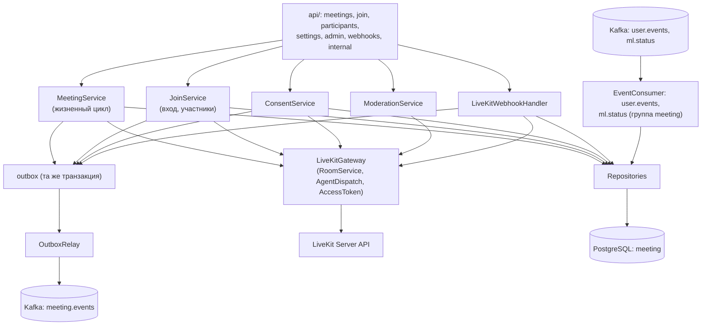

# meeting-service

## Назначение

Центральный сервис плоскости управления: встречи, приглашения, участники, согласия и вся интеграция с LiveKit
(токены, комнаты, модерация, вебхуки, запуск ML-агента). Единственный сервис, который управляет LiveKit через Server API.

## Ответственность

- CRUD встреч организатора; код приглашения; история с поиском и фильтрами (функции 6.2, 6.8).
- Жизненный цикл встречи: `scheduled → active → ended | cancelled`.
- Вход во встречу: организатора (по JWT) и гостя (по коду приглашения) с регистрацией участника.
- Согласие на анализ: прием решения, журнал `consents`, синхронизация атрибута `vks.consent` в LiveKit (функция 6.4).
- Выдача токенов LiveKit с правильными правами и атрибутами.
- Модерация: выключить микрофон/камеру участника, удалить участника (функция 6.3).
- Прием вебхуков LiveKit: `participant_joined`, `participant_left`, `room_finished`.
- Запуск ML-агента в комнате (диспетчеризация LiveKit Agents), если анализ включен.
- Настройки организатора по умолчанию (анализ вкл/выкл, частота) (функция 6.10).
- Администрирование: список активных встреч, агрегированное состояние Системы.
- Публикация событий в топик Kafka `meeting.events` (через outbox); потребление `user.events` (блокировка и удаление
  организатора) и `ml.status` (состояние ML для `/admin/health`) – группа `meeting`.

## Внешний API (через Nginx)

| Метод | Путь | Доступ | Описание |
|---|---|---|---|
| POST | `/api/v1/meetings` | организатор | Создать встречу |
| GET | `/api/v1/meetings` | организатор | Список: `status`, `q`, `from`, `to`, пагинация |
| GET/PATCH/DELETE | `/api/v1/meetings/{id}` | владелец | Карточка / изменение / удаление (отмена) |
| POST | `/api/v1/meetings/{id}/join` | владелец | Войти (и активировать встречу) → токен LiveKit |
| POST | `/api/v1/meetings/{id}/end` | владелец | Завершить встречу |
| GET | `/api/v1/meetings/{id}/participants` | владелец | Участники и их согласие |
| POST | `/api/v1/meetings/{id}/participants/{pid}/mute` | владелец | `{kind: audio \| video}` |
| POST | `/api/v1/meetings/{id}/participants/{pid}/remove` | владелец | Удалить из встречи |
| GET | `/api/v1/join/{invite_code}` | все | Публичная информация о встрече для лобби |
| POST | `/api/v1/join/{invite_code}` | все | Вход гостя → `participant_token`, токен LiveKit |
| PUT | `/api/v1/participants/me/consent` | participant_token | Изменить решение о согласии |
| POST | `/api/v1/participants/me/rejoin` | participant_token | Новый токен LiveKit после перезагрузки вкладки |
| GET/PUT | `/api/v1/settings` | организатор | Настройки анализа по умолчанию |
| GET | `/api/v1/admin/meetings` | admin | Активные/все встречи (без аналитики) |
| GET | `/api/v1/admin/health` | admin | Состояние всех компонентов |
| POST | `/webhooks/livekit` | LiveKit (подпись) | Вебхуки (не через `/api`, доступ только из внутренней сети) |

### Внутренний API

| Метод | Путь | Потребитель | Описание |
|---|---|---|---|
| GET | `/internal/meetings/{id}/access?user_id=` | realtime-service | `{allowed, role}` – владелец ли пользователь |
| GET | `/internal/meetings/{id}` | analytics-service | Досинхронизация проекции (встреча + участники) |

## Внутренние компоненты

`LiveKitGateway` – единственная точка зависимости от LiveKit в плоскости управления (требование
заменяемости медиасервера).

## Ключевые правила

- Гость не может войти во встречу со статусом, отличным от `active` (`409 meeting_not_started` / `meeting_ended`).
- Во встречу не более 10 участников одновременно (`max_participants` комнаты LiveKit = 11 с учетом агента) –
  при превышении `409 meeting_full`.
- Если `analysis_enabled = false`, согласие не запрашивается, атрибут `vks.consent = not_required`, агент не запускается.
- Изменение согласия: в одной транзакции – журнал `consents`, `participants.consent_state`, событие `consent.changed`
  в outbox; затем `UpdateParticipant` в LiveKit. Если LiveKit недоступен – задача в `livekit_sync_queue`, клиенту `202`
  (подробно – [conventions.md](conventions.md#5-межсервисные-вызовы), [background-jobs.md](background-jobs.md)).
- Обработка вебхуков идемпотентна (по `event.id`).
- Встреча, активная без участников дольше `empty_timeout` (5 мин), закрывается LiveKit → `room_finished` → `ended`.
- Встреча, запланированная, но не начатая в течение 24 ч после `scheduled_at`, переводится в `cancelled`
  (фоновая задача раз в час).

## Интеграция с LiveKit

Подробно – [../api/livekit-integration.md](../api/livekit-integration.md).

## Данные

Схема `meeting` – [../04-data-model.md](../architecture/04-data-model.md#42-схема-meeting-meeting-service).

## Состояние реализации

| Часть | Задача | Статус |
|---|---|---|
| Схема `meeting`: встречи, участники, журнал согласий, настройки организатора | EMO-51 | ✓ |
| `POST/GET /meetings`, `GET /meetings/{id}`, `POST /meetings/{id}/join`, `POST /meetings/{id}/end` | EMO-53 | ✓ |
| `GET/POST /join/{invite_code}`, `POST /participants/me/rejoin`, токены LiveKit с атрибутами `vks.*` | EMO-53 | ✓ |
| События `meeting.created`, `meeting.started`, `participant.registered`, `consent.changed`, `meeting.ended` через outbox | EMO-52 | ✓ |
| `PATCH/DELETE /meetings/{id}` (события `meeting.updated`, `meeting.cancelled`, `meeting.deleted`), `GET/PUT /settings` | EMO-68 | ✓ |
| `Idempotency-Key` для `POST /meetings` (Redis) | EMO-68 | спринт 4 |
| `POST /webhooks/livekit`: присутствие участников, `participant.joined/left`, `room_finished` → `ended` | EMO-69 | ✓ |
| `409 meeting_full` по участникам в комнате; потребитель `user.events`: `403 user_blocked`, удаление встреч по `user.deleted` | EMO-69 | ✓ |
| Ограничение частоты `/join/{invite_code}` (`429`, Redis) | EMO-69 | спринт 4 |
| Модерация (`mute`, `remove`), список участников | EMO-70 | спринт 4 |
| `PUT /participants/me/consent`, `livekit_sync_queue`, запуск ML-агента | EMO-84 | спринт 5 |

Предел в 10 участников проверяет meeting-service при входе – по присутствию из вебхуков. Гость, получивший токен, но
еще не подключившийся, в этом счете не виден; такую гонку закрывает сама комната LiveKit (`max_participants = 11` с
учетом агента).

Потребитель `user.events` (группа `meeting`, с начала топика) запускается вместе с релеем outbox, если задан
`KAFKA_BOOTSTRAP_SERVERS`. Вебхуки подписываются ключом `LIVEKIT_API_KEY`: в конфигурации LiveKit
(`webhook.api_key`) должен стоять тот же ключ.

## Конфигурация

| Переменная | По умолчанию | Описание |
|---|---|---|
| `DATABASE_URL` | – (обязательна) | `postgresql+asyncpg://meeting_svc:…@postgres:5432/vks` |
| `ENV` | `development` | `development` \| `test` \| `production` |
| `LOG_LEVEL` | `INFO` | Уровень журналов |
| `JWKS_URL` | `http://127.0.0.1:8001/api/v1/auth/.well-known/jwks.json` | Публичные ключи auth-service для проверки access-токенов |
| `JWT_ISSUER`, `JWT_AUDIENCE` | `vks-auth`, `vks` | Ожидаемые `iss` и `aud` access-токена |
| `PUBLIC_BASE_URL` | `http://localhost:5173` | Адрес фронтенда: ссылка-приглашение `<PUBLIC_BASE_URL>/j/<код>` |
| `LIVEKIT_URL` | `http://localhost:7880` | Server API LiveKit (внутренняя сеть) |
| `LIVEKIT_PUBLIC_URL` | `ws://localhost:7880` | Адрес сигнализации для браузера участника (`livekit_url` в `JoinResult`) |
| `LIVEKIT_API_KEY`, `LIVEKIT_API_SECRET` | – (обязательны) | Ключ и секрет API, те же, что у сервера LiveKit; секрет – не короче 32 символов |
| `LIVEKIT_TOKEN_TTL_SECONDS` | `21600` | Срок токена участника (6 ч) |
| `LIVEKIT_TIMEOUT_SECONDS` | `3` | Таймаут вызова Server API; два повтора идемпотентных операций |
| `KAFKA_BOOTSTRAP_SERVERS` | – | Брокер Kafka; не задан – события копятся в `meeting.outbox` |
| `OUTBOX_POLL_INTERVAL_SECONDS` | `1` | Опрос outbox без сигнала о новой транзакции |

Любая переменная с секретом может быть передана файлом: `<ИМЯ>_FILE=/run/secrets/…`.

`/ready` проверяет PostgreSQL (критично), LiveKit (`ListRooms`) и Kafka (метаданные кластера) – обе некритичны: без
LiveKit не войти во встречу, но история и карточки работают; без Kafka события ждут в outbox.

