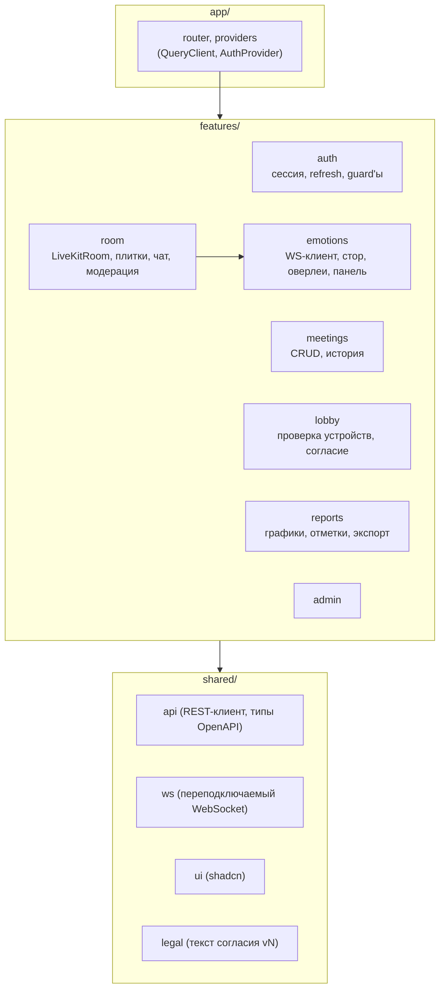

# Клиентская часть (frontend)

## Назначение

Одностраничное приложение для всех ролей: организатор, участник-гость, администратор. Собирается в статические
файлы и раздается Nginx. Интерфейс на русском языке.

Запуск и команды – [frontend/README.md](../../frontend/README.md). Дополнительно:
[структура сайта: роли, экраны, UC](site-structure.md) · [заметки по WebRTC и LiveKit](webrtc-livekit-notes.md) ·
[UI-кит и визуальный стиль](ui-kit.md) · [визуализация эмоций](emotion-visualization.md) ·
[макеты экранов](mockups.md) · [план тестирования](../testing/test-plan.md).

## Технологии ([ADR-006](../adr/ADR-006-frontend-stack.md))

| Задача | Библиотека |
|---|---|
| Основа | React 19, TypeScript (strict), Vite |
| Маршрутизация | React Router |
| Запросы к REST, кеш | TanStack Query; клиент на `fetch` с типами из `openapi-typescript` |
| Локальное состояние | Zustand (сессия, состояние панели эмоций) |
| Видеовстреча | `livekit-client`, `@livekit/components-react` (плитки, устройства, чат) |
| UI-компоненты | shadcn/ui (Radix) + Tailwind CSS |
| Графики | Recharts |
| Формы | React Hook Form + Zod |

## Маршруты

| Путь | Страница | Доступ |
|---|---|---|
| `/login`, `/register` | Вход, регистрация | только без сессии (вошедшего уводит на `/meetings`) |
| `/meetings` | История и запланированные встречи, поиск, фильтры | организатор, администратор |
| `/meetings/new` | Создание встречи | организатор , администратор |
| `/meetings/:id` | Карточка встречи: ссылка, параметры; для завершенной – отчет | организатор , администратор |
| `/room/:meetingId` | Комната организатора (видео + панель эмоций + модерация) | организатор, администратор; гость входит из лобби |
| `/j/:inviteCode` | Лобби гостя (устройства, имя, согласие) → комната | все |
| `/settings` | Устройства, анализ по умолчанию, приватность | организатор , администратор |
| `/admin` | Пользователи, активные встречи, состояние сервисов | администратор |
| `/dev/ui`, `/dev/livekit` | UI-кит и песочница LiveKit – только в dev-сборке | разработчики |

## Структура модулей

## Слой API meeting-service

Код: `src/shared/api/meetings/`. Страницы и хуки TanStack Query (`features/meetings/queries.ts`) работают только
с интерфейсом `MeetingsApi` (создание, список с курсором, карточка, правка, удаление, вход и завершение,
участники и модерация, лобби, согласие, rejoin, настройки по умолчанию – [контракт](../api/rest-api.md), раздел 3).
Реализаций две, выбор – переменная `VITE_API_MODE`:

| Значение | Реализация |
|---|---|
| `mock` (по умолчанию) | данные в памяти вкладки, те же проверки и коды ошибок (`meeting_not_started`, `meeting_ended`, `meeting_cancelled`, `meeting_full`, `consent_required`, `notice_outdated`, `analysis_disabled`, `participant_removed`, `meeting_not_editable`, `idempotency_key_reused`) |
| `http` | `fetch`-клиент (`apiFetch`): Bearer организатора, `Authorization: Participant <токен>` для гостя, `Idempotency-Key` при создании встречи. Отвечает настоящий meeting-service (`make run-meeting`, порт 8002); для слабой машины остается облегченный `frontend/dev-api` (`pnpm dev:api`, без проверки JWT; [README](../../frontend/dev-api/README.md)) |

Типы написаны вручную и заменяются на `gen:api`, когда будет решено перейти на OpenAPI meeting-service. **Остаются на
тестовых данных** (`src/shared/mocks/`): отчет (analytics-service, спринт 5) и панель эмоций (realtime-сервис).

## Работа с аутентификацией

Код: `src/features/auth/` (провайдер, формы, охранники маршрутов), `src/shared/api/` (клиент и сессия).

- **Токены.** access-токен хранится только в памяти (Zustand, `shared/api/session.ts`), в `localStorage` и
  `sessionStorage` его нет; refresh-токен – в `HttpOnly`-cookie `vks_refresh`, JavaScript его не видит. Токены не
  пишутся в журнал.
- **Старт приложения.** `AuthProvider` вызывает `POST /auth/refresh`: есть живая cookie – сессия восстановлена
  (перезагрузка страницы не выходит из аккаунта), `401` – гость, сбой сети/сервера – экран «Нет связи с сервером»
  с кнопкой «Повторить».
- **Запросы.** `apiFetch` добавляет `Authorization: Bearer`, разбирает `application/problem+json` в `ApiError`
  (`code`, `errors[]` с `loc` → поле формы, `request_id`, `Retry-After`). На `401` выполняется **один** общий refresh
  (single-flight: refresh-токен одноразовый, второй обмен отозвал бы сессию) и запрос повторяется один раз.
- **Упреждающее обновление.** По `expires_in` токен обновляется за ~60 с до конца срока.
- **Выход.** `POST /auth/logout`; состояние очищается и при сбое сети, кэш запросов сбрасывается.
- **Маршруты.** `GuestOnly` (`/login`, `/register`), `RequireAuth` (страницы организатора), `RequireRole('admin')`
  (`/admin`), `RequireRoomAccess` (комната: сессия или гость из лобби). Неавторизованного отправляют на `/login` и
  после входа возвращают на исходный адрес.
- **Регистрация.** Сервер при `POST /auth/register` токены не выдает, поэтому после регистрации выполняется login.
  `GET /auth/config` → `registration_enabled = false` скрывает ссылку и форму.
- **Ошибки форм.** Коды `invalid_credentials`, `user_blocked`, `email_taken`, `validation_error`,
  `too_many_requests` (время из `Retry-After`), `404` при закрытой регистрации превращаются в тексты на русском
  (`features/auth/errors.ts`). Политика пароля (8–128 символов, буква и цифра, без пробелов по краям) повторена в
  Zod (`features/auth/schemas.ts`); сервер проверяет ее всегда.
- **Типы API.** Генерируются `pnpm gen:api` из OpenAPI auth-service (`src/shared/api/schema.d.ts`).
- **Гость.** `participant_token` выдает `POST /join/{invite_code}`; он хранится в `sessionStorage` вкладки
  (`shared/lib/participant-session.ts`) на время встречи – для отзыва согласия и повторного входа после перезагрузки.
  REST-вызовы гостя идут с `Authorization: Participant <токен>`, `livekit_token` нужен только для медиа.
  `RequireRoomAccess` пускает в `/room/:id` вошедшего организатора или администратора либо гостя, у которого в
  `sessionStorage` есть токен. Пока лобби на моке, токен фиктивный (`pt_mock_…`) и сервером не проверяется:
  проверка появится вместе с meeting-service (EMO-74, EMO-89).

### Что подключено к бэкенду и что на моках

Режим выбирает `VITE_API_MODE` (`http` – настоящие сервисы, `mock` – данные в памяти). Для смены пароля и
администрирования режим читается при вызове, поэтому его можно подменить в тесте.

| Что | `http` | `mock` |
|---|---|---|
| Вход, регистрация, профиль, refresh (auth-service) | Всегда настоящий сервис | – |
| Смена пароля `POST /users/me/password` | Настоящая: после 204 сессия очищается, переход на `/login` с сообщением «Пароль изменён, войдите снова»; на 401 `invalid_credentials` обмен refresh-токена и повтор не выполняются | Форма-макет, пароль не меняется («Тестовый режим») |
| `/admin`: пользователи (`GET`/`PATCH /admin/users`: список, поиск `q`, фильтр статуса, блокировка и разблокировка) | Настоящая | Тестовые данные в памяти |
| `/admin`: смена роли и удаление пользователей | **Не сделаны** (по решению: только список и блокировка) | – |
| `/admin`: активные встречи, состояние сервисов | **Заглушки «Скоро»**: `GET /admin/meetings` и `/admin/health` в meeting-service не реализованы | – |
| Встречи, лобби, комната, настройки анализа, модерация | meeting-service (или `dev-api`) | Мок слоя API |
| Переключатель «Анализ моих эмоций» (`PUT /participants/me/consent`) | В meeting-service эндпоинта пока нет (404/405): переключатель остается на месте, сообщение «Пока недоступно: сервер ещё не поддерживает эту функцию» | Работает на моке |
| Панель эмоций, сводка, отчет | Тестовые данные с пометкой «Демонстрационные данные» (realtime- и analytics-сервисы) | То же |
| Восстановление пароля | Не реализовано ни на бэкенде, ни на фронтенде | – |

Открытые вопросы к бэкенду – [testing/backend-questions.md](../testing/backend-questions.md).

**Проверено вживую против настоящих auth-service, meeting-service и LiveKit** (29.10.2026, `pnpm test:e2e:real`,
3 теста): вход через форму, создание встречи, «Начать сейчас», лобби и вход гостя, комната с двумя участниками
(видео, звук, чат), модерация, удаление, завершение, смена пароля; предел 10 – по REST и присутствию. **Не проверено
вживую:** админка (администратор не создавался), Kafka, `429`, `503`, галерея из 10 через интерфейс. Подробности –
[testing/sprint4-frontend-status.md](../testing/sprint4-frontend-status.md).

## Комната встречи

Режим `http` (`VITE_API_MODE=http`, meeting-service или облегченный `dev-api`); подробности и экраны –
[site-structure.md, 4.3](site-structure.md). Режим `mock` показывает демонстрационную комнату без видео.

- `LiveKitRoom` подключается по `livekit_url` и `livekit_token` из слоя API (rejoin / вход организатора); включены
  `adaptiveStream` и `dynacast`, устройства из лобби (`localStorage`) применяются как значения по умолчанию.
- Раскладка «галерея» – `GridLayout` + пагинация (`TILES_PER_PAGE = 12`, лимит комнаты 10); свои дорожки видны всем.
- Состав участников, роли и согласие – из самого LiveKit (`name`, атрибуты `vks.role`, `vks.consent`, `vks.kind`),
  REST-список участников нужен только организатору для модерации.
- Чат – `useChat` (текстовые потоки, тема `lk.chat`); история только в памяти вкладки.
- История чата: сообщения хранятся в `sessionStorage` вкладки (до 200, переживают обновление страницы) и
  синхронизируются между участниками через LiveKit (тема `vks.chat.sync`: запрос при входе, ответ одного участника с
  наименьшей `identity`, до 50 сообщений частями до ~12 КБ), на сервере не хранятся; подробности и ограничения –
  [ADR-008](../adr/ADR-008-chat-via-livekit-data.md). Историческая пачка не считается непрочитанной.
- Состояние после обновления страницы: микрофон и камера (`vks.room.devices.<id встречи>`, пишется при каждом
  переключении, первый вход – значения из лобби); таймер встречи считается от `started_at` (у организатора), а у
  гостя – от самого раннего входа участника в комнату (в ответе на вход гостя `started_at` по контракту нет), оценка
  запоминается во вкладке. Явный выход, завершение встречи и удаление очищают запись.
- Уведомления чата: пока панель чата не видна, чужие сообщения считаются непрочитанными – бейдж на кнопке «Чат»
  (`9+` после девяти, `aria-label` «Чат, непрочитанных: N»), всплывающее «Имя: текст» в углу видео (до 80 символов,
  4 с, не больше трех, `role="status"`, клик открывает чат) и счетчик в заголовке вкладки «(N) ReactiVKS». Свои
  сообщения не считаются, открытие чата обнуляет счетчик. Звука нет.
- Реакции: кнопка «Реакции» открывает шесть эмодзи (👍 ❤️ 😂 😮 👏 🎉). Реакция уходит как `publishData` в теме
  `vks.reaction` (`reliable: false`, JSON `{ v: 1, emoji }`). Эмодзи всплывают в одной полосе внизу слева над панелью
  управления (до 8 одновременно, с подписью-ником, случайный сдвиг не больше 12 px, без движения при
  `prefers-reduced-motion`); одинаковые реакции одного отправителя в течение 2 с склеиваются в «×N». Лимит на
  отправителя – не чаще одной в секунду и не больше пяти за 10 секунд: при превышении кнопки `aria-disabled`, подпись
  «Слишком часто. Подождите ещё N с» (до 10 с). Те же лимиты действуют на приеме. В чат реакции не попадают и в
  непрочитанные не входят. Входящее проверяется: тема, формат, белый список эмодзи, ник только из участника LiveKit
  ([протокол](../api/livekit-integration.md#темы-данных)).
- Раскладка комнаты: корень закреплен на всё окно (`position: fixed; inset: 0; overflow: hidden`), `html` и `body`
  на время комнаты без прокрутки, прокручиваются только внутренние панели; выпадающие панели «Устройства» и «Реакции»
  – `fixed` по центру окна, чтобы их не обрезала прокручиваемая нижняя панель. Проверка – `pnpm test:e2e:layout`.
- Индикатор «Идет анализ эмоций» – по присутствию участника `vks.kind = agent`; агент не показывается в плитках и
  списке участников.
- Панель управления своя, на хуках LiveKit, подписи по-русски: микрофон, камера, «Устройства» (выбор динамика
  только там, где есть `setSinkId`), «Анализ моих эмоций» → `PUT /participants/me/consent`, участники, эмоции, чат,
  «Выйти», «Завершить встречу».
- Модерация организатора (микрофон, камера, удалить, завершить) → REST meeting-service, каждое действие с
  подтверждением. Удаленному гостю повторный вход блокирует `rejoin` (`participant_removed`).
- **Остается на моке:** панель эмоций, сводка и отчет (до realtime- и analytics-сервисов) – с пометкой
  «Демонстрационные данные» в интерфейсе.

## Панель эмоций (только организатор)

- `EmotionSocket` подключается к `wss://vks.<домен>/ws`, отправляет `subscribe {meeting_id}`
  ([протокол](../api/websocket-protocol.md)).
- Стор `useEmotionStore`: для каждого участника кольцевой буфер последних 5 минут (≤ 1 500 точек при 5 кадр/с),
  текущее состояние (`dominant`, `confidence`, `state`).
- Отображение:
  - оверлей на плитке: иконка/цвет доминирующей эмоции и процент;
  - боковая панель: карточка на участника (текущая эмоция, мини-график 5 мин), сводка встречи
    (распределение эмоций по всем участникам, доля негативных);
  - статусы: «без анализа» (нет согласия), «лицо не обнаружено», «анализ недоступен»;
  - кнопка «Отметить момент» → `POST /api/v1/reports/{meeting_id}/markers` (ручная отметка для отчета).
- Отрисовка графиков троттлится до 4 раз/с, чтобы не нагружать браузер во время видеовстречи.
- Постоянный дисклеймер о вероятностном характере результатов.

## Отчет

Графики Recharts: стековая площадь вероятностей по времени (на встречу и на участника), круговые/столбчатые
распределения, отметки ключевых моментов на оси времени, таблица участников. Кнопки экспорта PDF/CSV –
прямые ссылки на analytics-service (с access-токеном в заголовке через `fetch` → `Blob`).

## Поддержка браузеров

Chrome, Edge, Яндекс Браузер, Firefox – последние 2 версии; Safari 17+ (для участников). Перед входом – проверка
`RTCPeerConnection`, `getUserMedia` и понятное сообщение при отсутствии поддержки.
