# Макеты экранов

Результат задачи EMO-52 (спринт 3). Макеты – это сами страницы приложения на тестовых данных, снятые Playwright
в двух ширинах: **1280 px** (рабочий стол) и **360 px** (телефон, минимальная ширина по ui-kit.md). Отдельный
файл в Figma или Penpot не ведется: источник правды – код и [ui-kit.md](ui-kit.md).

Перегенерация скриншотов: `pnpm dev` не нужен (Playwright сам поднимет сервер), бэкенд не нужен (ответы
auth-service подменяются в скрипте):

```bash
cd frontend
pnpm mockups                      # все экраны
SHOTS=report,room pnpm mockups    # только выбранные
```

Скрипт – `frontend/e2e/mockups.shots.ts`, файлы – `docs/frontend/mockups/<экран>-<ширина>.png`. Используется
только Chromium, камера заменена нарисованным силуэтом.

## Экраны

| Экран | Путь | 1280 px | 360 px | UC |
|---|---|---|---|---|
| Вход | `/login` | 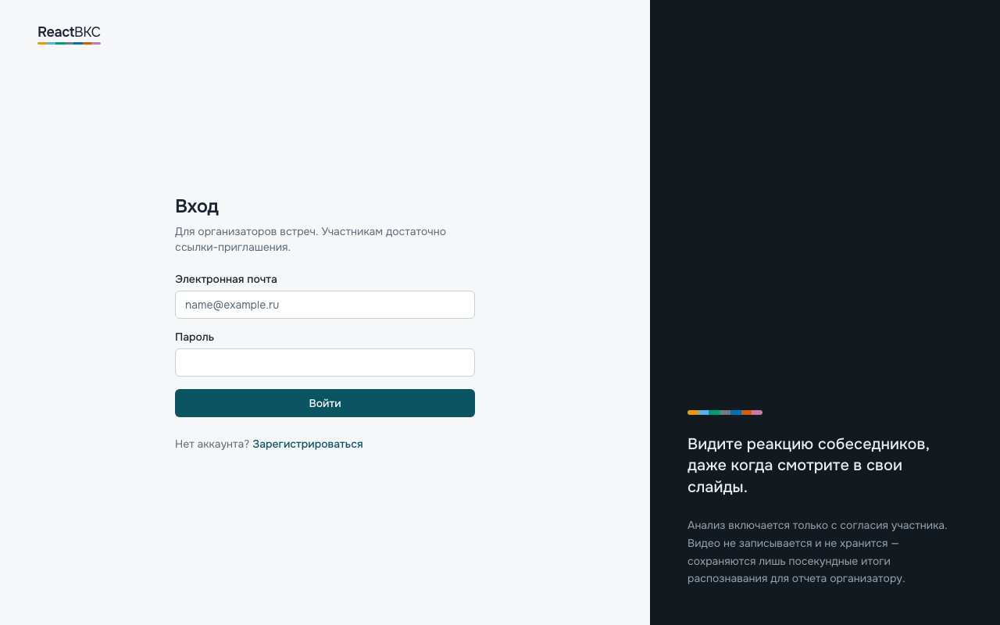 | 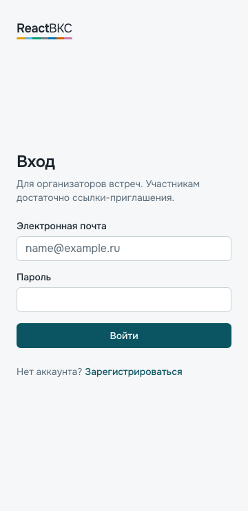 | UC-1 |
| Регистрация | `/register` | 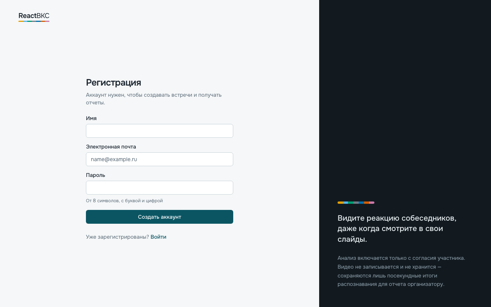 | 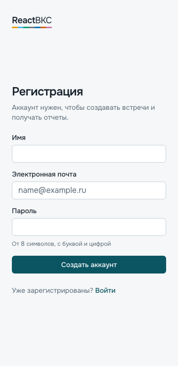 | UC-1 |
| Главная | `/meetings` | 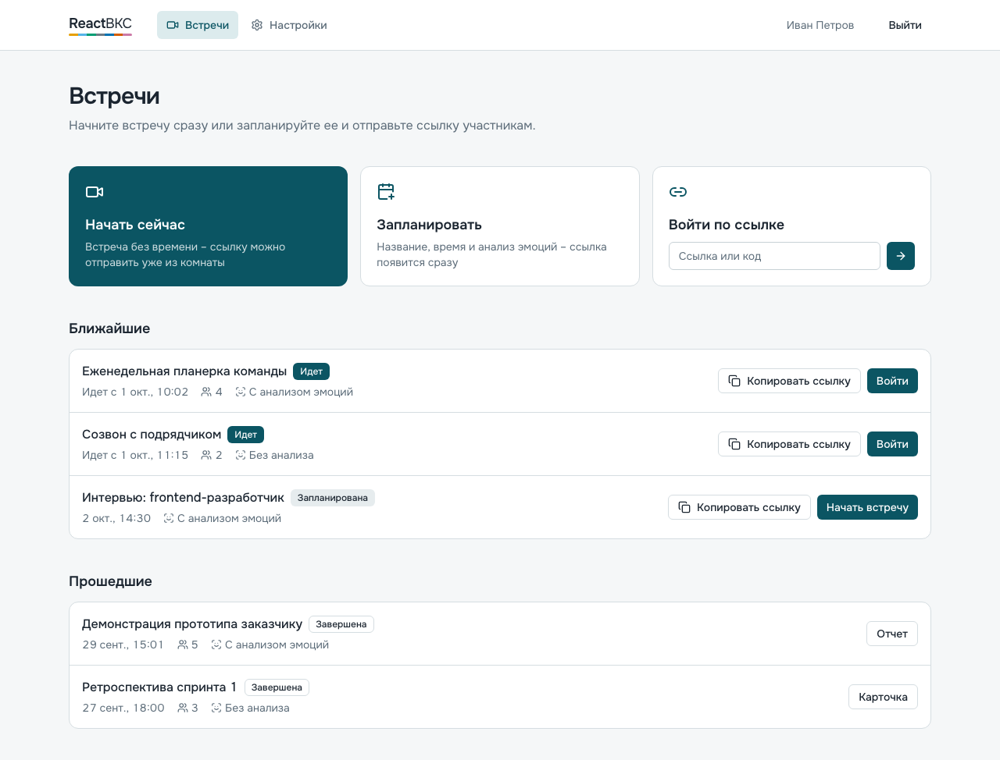 | 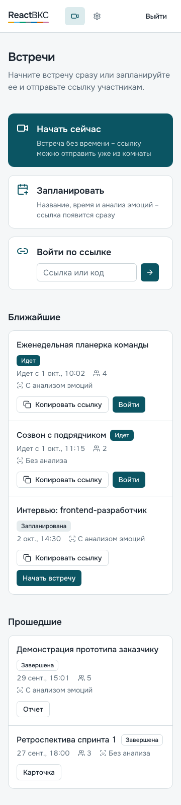 | UC-2 |
| Создание встречи | `/meetings/new` | 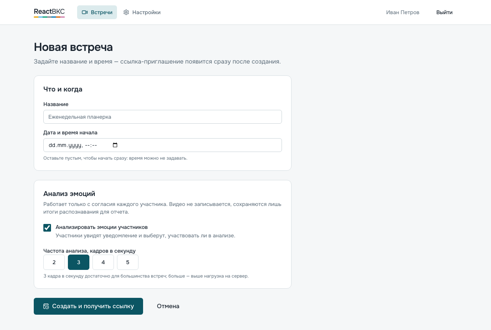 | 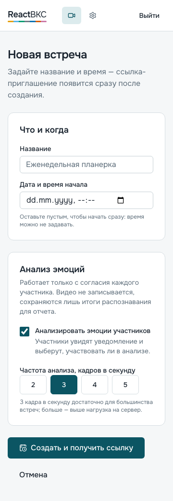 | UC-2 |
| Карточка встречи | `/meetings/:id` | 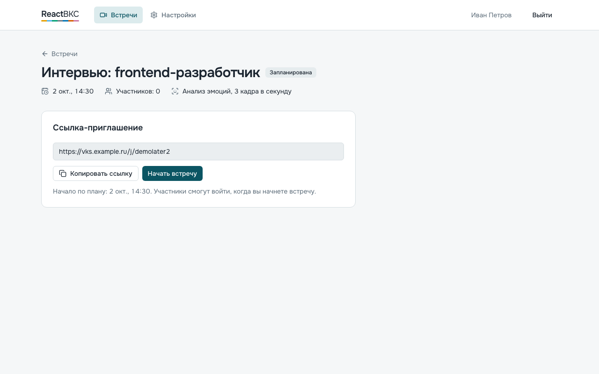 | 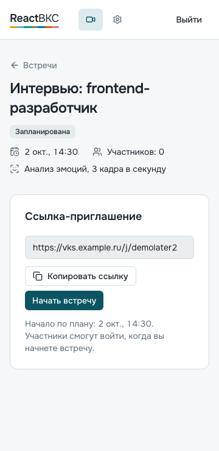 | UC-2 |
| Личный кабинет | `/settings` | 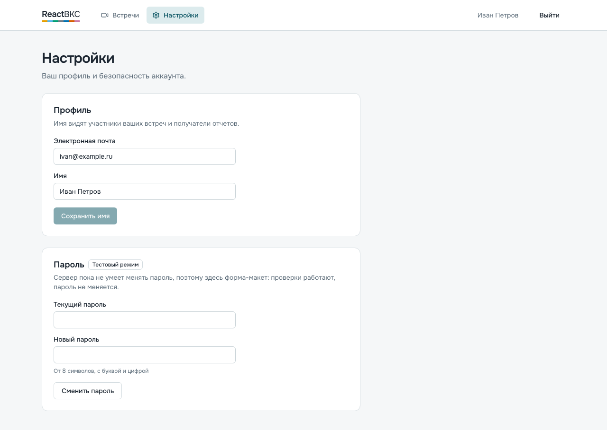 | 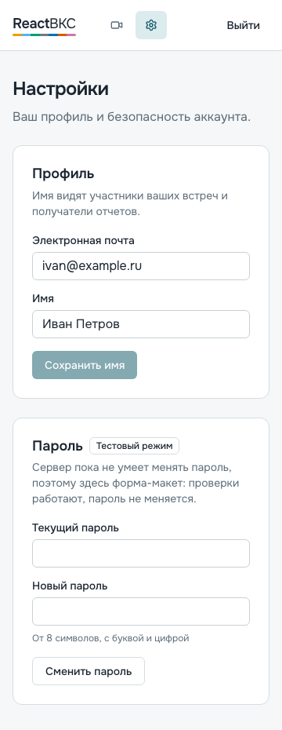 | – |
| Лобби, проверка устройств | `/j/:inviteCode` | 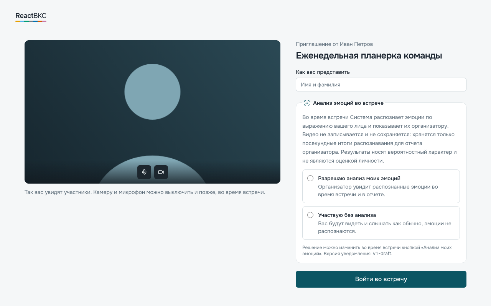 | 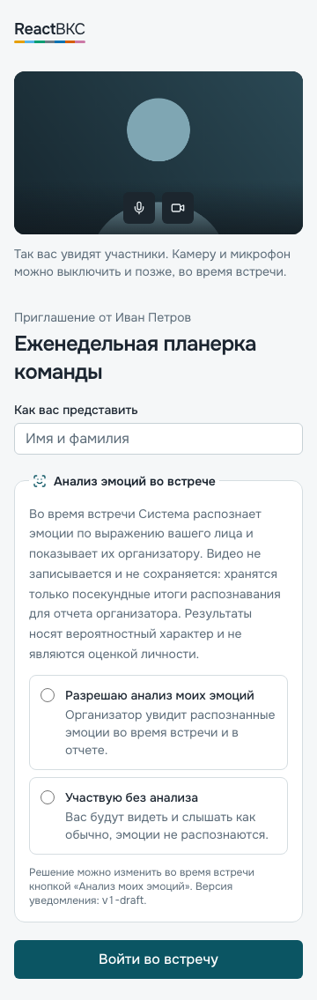 | UC-3 |
| Комната | `/room/:meetingId` | 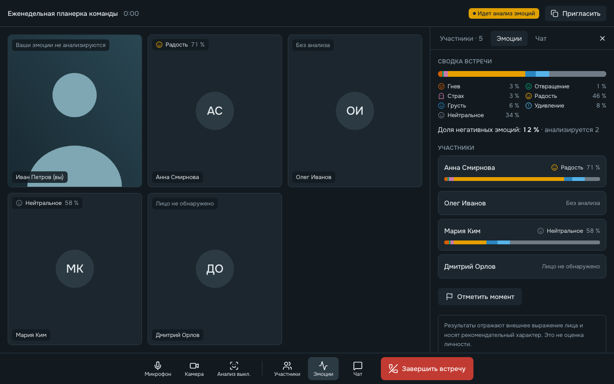 | 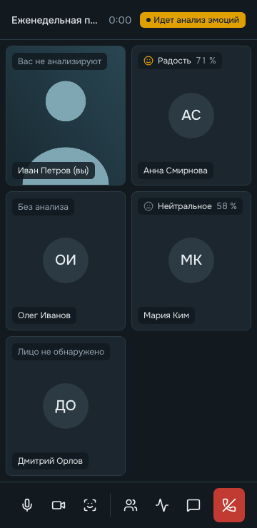 | UC-4 |
| Комната с панелью эмоций | `/room/:meetingId` |  | 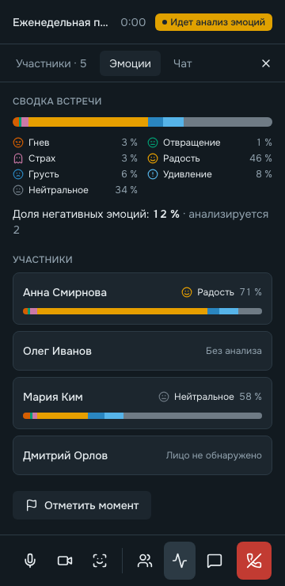 | UC-4 |
| Отчет | `/meetings/:id` (завершенная) | 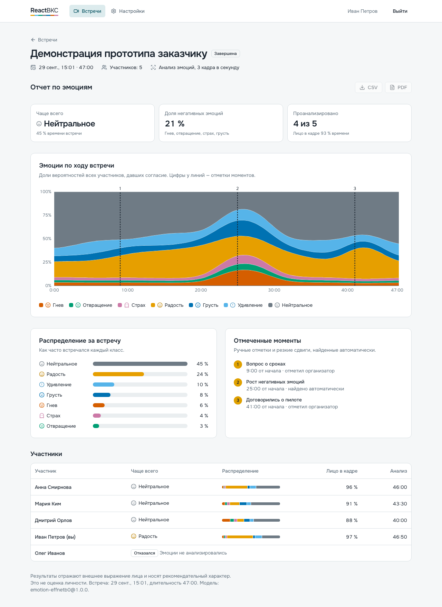 | 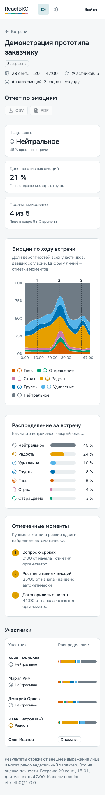 | UC-5 |
| Визуализация эмоций | `/dev/ui` | 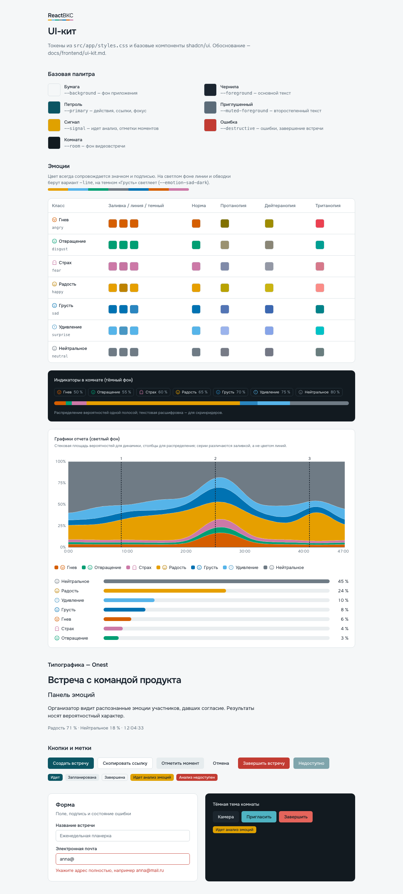 | 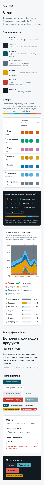 | – |

На 1280 px панель эмоций у организатора открыта сразу, поэтому «Комната» и «Комната с панелью эмоций» совпадают;
на 360 px панель открывается поверх галереи по кнопке «Эмоции».

## Решения по экранам

Структура – по [site-structure.md](site-structure.md) (приемы Salute Jazz без копирования цветов и графики).

- **Главная.** Три плитки действий: «Начать сейчас» (основной цвет), «Запланировать», «Войти по ссылке» с полем.
  На 360 px плитки становятся компактными строками (значок слева), чтобы список встреч начинался на первом экране.
- **Создание встречи.** Форма по контракту `POST /meetings`: название, время (пусто = «сейчас»), флажок анализа и
  частота 2–5 кадров/с сегментированным переключателем (недоступна при выключенном анализе). После создания –
  ссылка-приглашение с копированием: UC-2 укладывается в «Запланировать» → «Создать» → «Копировать ссылку».
- **Лобби.** Две колонки: превью камеры слева, имя, согласие и «Войти во встречу» справа; согласие без выбора по
  умолчанию. На 360 px колонки друг под другом, превью сверху.
- **Комната.** Тёмная; шапка с названием, временем и индикатором «Идет анализ эмоций» (виден всем); галерея; нижняя
  панель с подписанными кнопками, «Завершить встречу» отдельным красным пунктом; справа вкладки «Участники»,
  «Эмоции», «Чат». У участника без анализа на собственной плитке – пометка «Вас не анализируют».
- **Панель эмоций.** Сводка встречи (полоса распределения, значки, доля негативных), карточки участников,
  «Отметить момент», постоянный дисклеймер. Правила цвета – [emotion-visualization.md](emotion-visualization.md).
- **Отчет.** Три показателя сверху, стековая площадь вероятностей с отметками моментов, распределение столбцами,
  список моментов, таблица участников. Данные – тестовый отчет `shared/mocks/report.ts` в форме `GET /reports/{id}`.
  Экспорт CSV/PDF показан отключенным кнопками: он появится в спринте 5.

## Что исправлено по результатам просмотра скриншотов

- Отчет, 360 px: на оси Y обрезалось «100%» (отображалось «00%») – увеличены отступы графика.
- Отчет, 360 px: таблица участников уходила в горизонтальную прокрутку – скрыты столбцы «Лицо в кадре» и
  «Анализ», доминирующая эмоция перенесена под имя.
- Комната, 360 px: пометка на собственной плитке занимала две строки и перекрывала видео – на узких экранах
  короткий текст «Вас не анализируют».
- Главная, 360 px: плитки действий занимали почти весь первый экран – сделаны компактными.
- Макеты снимались с зеленой тестовой картинкой камеры Chromium – заменена спокойным силуэтом.

## Ограничения

- Тестовые данные: встречи, участники, эмоции и отчет не приходят с сервера; это сделает EMO-73, EMO-90, EMO-92.
- Размеры 768 и 1024 px отдельно не снимались; поведение боковой панели на них описано в site-structure.md и
  проверено только в тестах и вручную не оценивалось.
- Темная тема всего приложения не предусмотрена (только комната).
