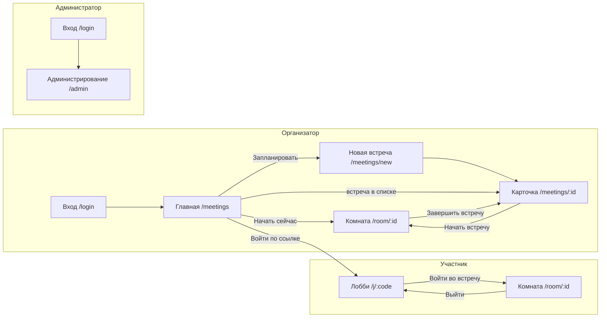

# Структура сайта: роли, экраны, прецеденты

Карта экранов клиентской части по ролям и прецедентам UC-1…UC-7 ([03-scenarios.md](../architecture/03-scenarios.md)).
Маршруты – [README.md](README.md#маршруты), визуальный стиль – [ui-kit.md](ui-kit.md).

## 1. Роли

| Роль | Как попадает в Систему | Аккаунт | Что видит |
|---|---|---|---|
| Организатор | Вход по e-mail и паролю | Да (`role = organizer`) | Свои встречи, комнату с панелью эмоций, отчеты |
| Участник | Ссылка-приглашение `/j/{invite_code}` | Нет (`participant_token` на время встречи) | Лобби и комнату; свой статус согласия, но не чужие эмоции |
| Администратор | Вход по e-mail и паролю | Да (`role = admin`) | Пользователей, идущие встречи, состояние сервисов. Отчетов организаторов **не** видит ([05-security-privacy.md](../architecture/05-security-privacy.md#53-авторизация)) |

Может ли администратор проводить собственные встречи как организатор, пока не решено: вопрос к архитектору.
До решения навигация администратора та же, что у организатора, плюс раздел «Администрирование». Этот пункт меню
виден только роли `admin` (роль берется из `useAuth()`), сам маршрут `/admin` закрыт `RequireRole`.

## 2. Карта «роль × экран × UC»

● – основной пользователь экрана, ○ – экран доступен с ограничениями, – – недоступен.

| Экран | Путь | Организатор | Участник | Админ. | UC | Задачи |
|---|---|:-:|:-:|:-:|---|---|
| Вход | `/login` | ● | – | ● | UC-1 | EMO-39 |
| Регистрация | `/register` | ● | – | – | UC-1 | EMO-39 |
| Главная: действия и встречи | `/meetings` | ● | – | ○ | UC-2, UC-5 | EMO-73, EMO-106 |
| Новая встреча | `/meetings/new` | ● | – | ○ | UC-2 | EMO-73 |
| Карточка встречи / отчет | `/meetings/:id` | ● | – | – | UC-2, UC-5, UC-6 | EMO-73, EMO-92, EMO-106 |
| Лобби | `/j/:inviteCode` | ○ ¹ | ● | – | UC-3 | EMO-74, EMO-89 |
| Комната | `/room/:meetingId` | ● ² | ● ² | – | UC-4 | EMO-57, EMO-75, EMO-89–91 |
| Настройки | `/settings` | ● | – | ○ | – | EMO-106 |
| Администрирование | `/admin` | – | – | ● | UC-7 | EMO-106 |
| Страница не найдена | `*` | ● | ● | ● | – | EMO-19 |

¹ Организатор входит в свою встречу кнопкой «Начать встречу» из карточки или главной, минуя лобби гостя;
по ссылке-приглашению он попадает в лобби как обычный участник.
² Комната одна, состав зависит от роли – см. [раздел 4.3](#43-комната-roommeetingid).

## 3. Навигация

## 4. Ключевые экраны

Структуру экранов берем у Salute Jazz: плитки действий на главной, двухколоночное лобби с превью камеры,
комната с боковой панелью и нижней панелью управления. Цвета, иконографию и графику не копируем: палитра, шрифт
Onest и компоненты – из UI-кита. Комната тёмная, остальные экраны светлые.

### 4.1 Главная (`/meetings`)

| Зона | Содержимое |
|---|---|
| Приветствие | Заголовок «Встречи» и короткая подсказка |
| Плитки действий | «Начать сейчас» (встреча без времени → комната), «Запланировать» (→ `/meetings/new`), «Войти по ссылке» (поле для ссылки или кода → лобби) |
| Поиск | Одно поле «Поиск по названию» (пауза 300 мс), применяется к обоим разделам |
| Ближайшие | `GET /meetings?status=scheduled,active`: название, время, статус, анализ вкл/выкл, действия по статусу. Свой курсор и кнопка «Ещё» |
| Прошедшие | `GET /meetings?status=ended,cancelled`: то же, отдельным запросом со своим курсором и кнопкой «Ещё». Сбой одного раздела не ломает другой |

UC-2 укладывается в 3 действия: ввести название → «Создать» → «Копировать ссылку» (форма открывается со значениями из `GET /settings`; проверяется тестом `MeetingNewPage.test.tsx`).

### 4.2 Лобби (`/j/:inviteCode`)

| Колонка | Содержимое |
|---|---|
| Левая (3/5) | Превью камеры (зеркально), переключатели камеры и микрофона, списки «Камера», «Микрофон» и «Динамик» (выбор запоминается в `localStorage`), индикатор уровня микрофона, «Проверить звук», сообщения о запрете доступа и об отсутствии устройств с кнопкой «Повторить». Динамик выбирается через `setSinkId` – в Firefox и Safari список скрыт, вместо него пояснение |
| Правая (2/5) | Название встречи и организатор, поле «Как вас представить», блок согласия, кнопка «Войти во встречу» |

Блок согласия показывается, только если во встрече включен анализ (`consent_notice ≠ null`):

- текст уведомления (`consent_notice.text_md`, версия `notice_version`);
- два варианта: «Разрешаю анализ моих эмоций» и «Участвую без анализа»; **вариант по умолчанию не выбран**,
  без явного выбора войти нельзя (ошибка `consent_required` на стороне API дублирует проверку);
- подсказка, что решение можно изменить в комнате.

Состояния и коды ошибок `POST /join/{invite_code}`. Клиент не зависит от порядка проверок на сервере: любой код из реестра обрабатывается на любом шаге.

| Код | Что видит пользователь |
|---|---|
| `meeting_not_started` | Блок «Встреча еще не началась»: вход повторяется каждые 5 с, «Отменить ожидание» останавливает опрос. Через 10 минут опрос прекращается, под формой сообщение, вход снова по кнопке. Временные сбои (сеть, 429, 5xx) опрос не прерывают |
| `meeting_ended`, `meeting_cancelled` | Экран «Встреча завершена» или «Встреча отменена» с именем организатора |
| `participant_removed` | Экран «Вас удалили из встречи» |
| `not_found` | Экран «Приглашение не найдено» |
| `forbidden`, `user_blocked` | Экраны «Нет доступа» и «Доступ закрыт» |
| `notice_outdated` | Выбор согласия сбрасывается, показывается новое уведомление |
| `validation_error` | Ошибка у поля имени |
| `unauthorized` | «Вас удалили из встречи или сессия недействительна» (для гостя 401 по `Participant`-токену) |
| `meeting_full`, `consent_required`, `livekit_unavailable`, `too_many_requests`, `internal_error` и остальные | Сообщение под формой, вход остается доступным |

Также: браузер без WebRTC или без HTTPS. `participant_token` кладется в `sessionStorage` вкладки.
На ширине < 768 px колонки идут одна под другой.

### 4.3 Комната (`/room/:meetingId`)

| Зона | Организатор | Участник |
|---|---|---|
| Шапка | Название, длительность, индикатор «Идет анализ эмоций» | То же |
| Галерея | Плитки до 10 участников, у согласившихся – индикатор эмоции | Плитки без индикаторов эмоций |
| Боковая панель | Вкладки «Участники» (статус согласия, модерация: выключить микрофон, удалить), «Эмоции», «Чат» | Вкладки «Участники» (без модерации) и «Чат» |
| Нижняя панель | Микрофон, камера, «Анализ моих эмоций», участники, эмоции, чат, «Завершить встречу» | Микрофон, камера, «Анализ моих эмоций», участники, чат, «Выйти» |

- Индикатор «Идет анализ эмоций» видят **все** участники, пока в комнате есть ML-агент.
- Кнопка «Анализ моих эмоций» есть у каждого, если анализ во встрече включен: отзыв и повторная выдача согласия
  (`PUT /participants/me/consent`).
- На вкладке «Эмоции» у каждого участника – текущая эмоция с уверенностью, распределение вероятностей и статус
  («без анализа», «лицо не обнаружено», «камера выключена»). Дисклеймер о вероятностном характере виден постоянно.
- Согласие организатора на анализ его собственных эмоций по умолчанию не дано: включается той же кнопкой.
- «Завершить встречу» у организатора требует подтверждения («Завершить встречу для всех?») и ведет в карточку
  встречи; «Выйти» у участника – экран выхода со ссылкой обратно в лобби.
- «Удалить из встречи» у организатора тоже требует подтверждения; «Отмена» и Escape закрывают диалог.
- На ширине < 1024 px боковая панель открывается поверх галереи.

## 5. Тестовые данные

Пока бэкенд не подключен, экраны главной, лобби и комнаты работают на тестовых данных из
`frontend/src/shared/mocks/`. Форма данных повторяет схемы [REST API](../api/rest-api.md) и
[протокола WebSocket](../api/websocket-protocol.md), чтобы при подключении API (EMO-40, EMO-90) заменить
только источник. Текст уведомления в тестовых данных – черновик до EMO-65.

| Приглашение | Сценарий |
|---|---|
| `/j/demoactive` | Встреча идет, анализ включен – блок согласия |
| `/j/demonoanal` | Встреча идет, анализ выключен – без блока согласия |
| `/j/demolater2` | Встреча еще не началась |
| `/j/demoended2` | Встреча завершена |
| любой другой код | Приглашение не найдено |

В комнату организатора можно попасть с главной («Начать сейчас» или встреча из списка). В комнату участника
можно попасть только через лобби: роль, имя и решение о согласии передаются из лобби.
