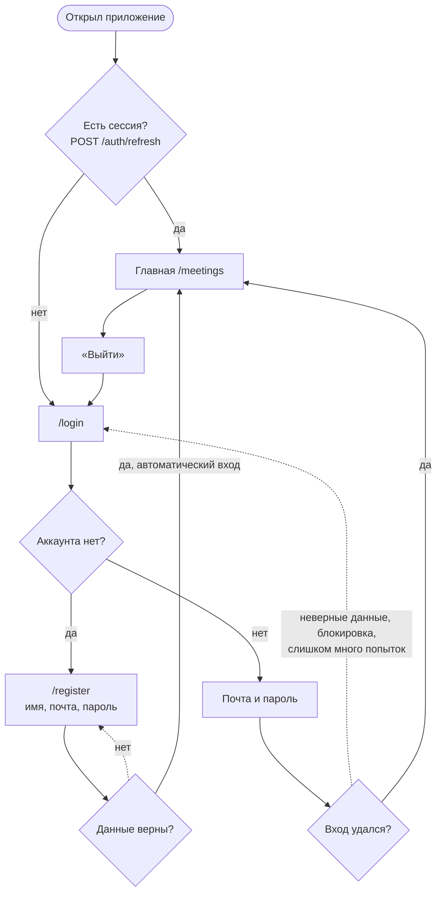
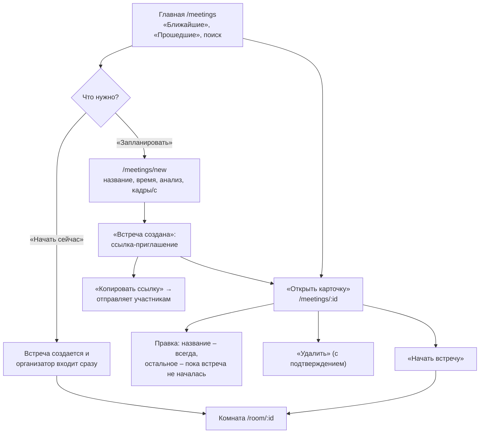
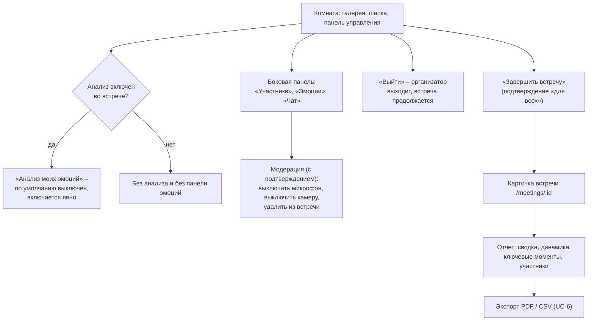
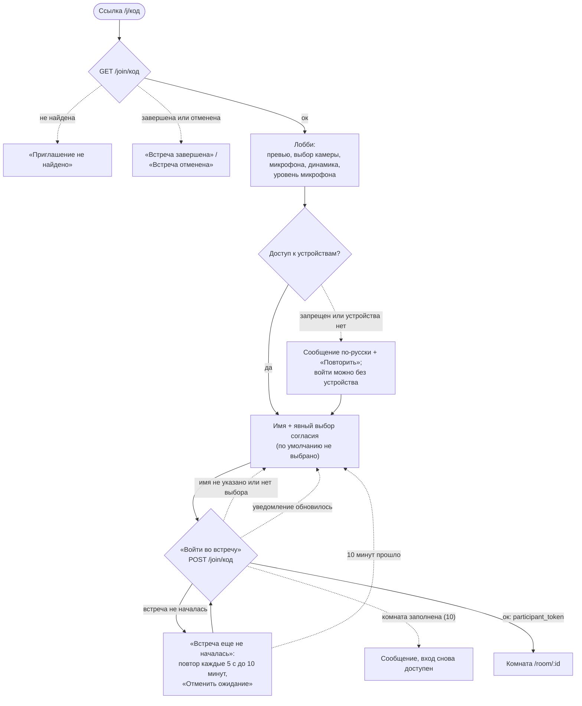
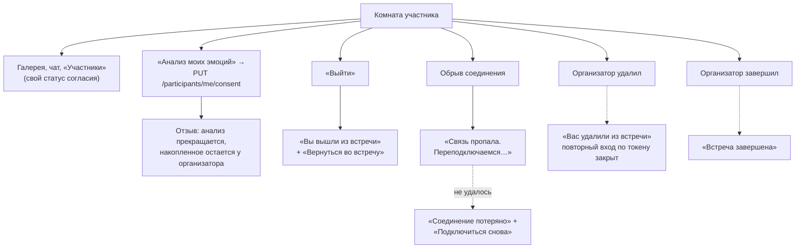
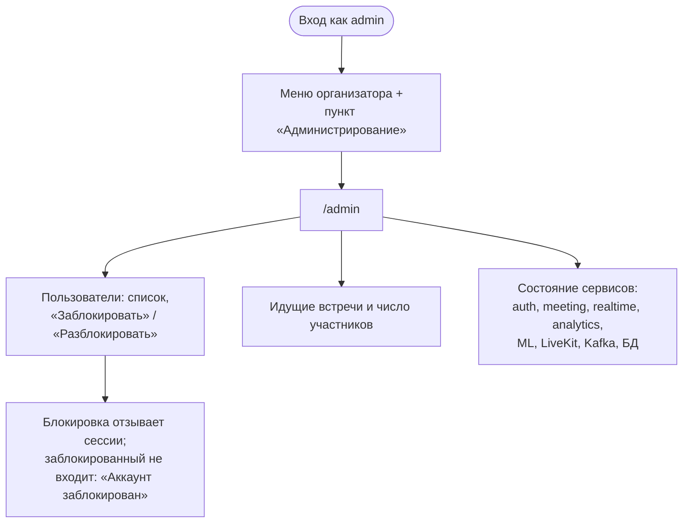

# Пользовательские потоки

Потоки трех ролей ([site-structure.md](site-structure.md), раздел 1) по прецедентам UC-1…UC-7 из
[03-scenarios.md](../architecture/03-scenarios.md). Диаграммы показывают путь пользователя по экранам клиента;
обмен с сервисами – в [03-scenarios.md](../architecture/03-scenarios.md), тест-сценарии –
[test-scenarios-uc1-uc3.md](../testing/test-scenarios-uc1-uc3.md).

Состояние реализации на 2026-10-28 (спринт 4): UC-1…UC-4 реализованы в клиенте (режим `mock` и режим `http`
на временном `dev-api`), панель эмоций, сводка и отчет (UC-5) – на тестовых данных, экспорт (UC-6) и
администрирование (UC-7) пока заглушки. Где поток еще не реализован, это отмечено в подписи к диаграмме.

Условные обозначения: прямоугольник – экран, ромб – решение системы или пользователя, скругленный – вход
или выход из потока, пунктир – переход по ошибке.

## 1. Организатор

### 1.1 Вход в Систему (UC-1)

После перезагрузки страницы сессия восстанавливается через `POST /auth/refresh` (cookie, `access_token` хранится
только в памяти). Закрытый маршрут без сессии ведет на `/login` и после входа возвращает на исходный адрес.

### 1.2 Создание и начало встречи (UC-2, начало UC-4)

Создание и отправка ссылки укладываются в три действия: ввести название → «Создать и получить ссылку» →
«Копировать ссылку».

### 1.3 Комната организатора (UC-4) и завершение (UC-5)

Панель эмоций, сводка и отчет сейчас на тестовых данных, в интерфейсе есть пометка «Демонстрационные данные».
Экспорт – заглушка, появится в спринте 5.

## 2. Участник (гость, без аккаунта)

### 2.1 Присоединение по ссылке (UC-3)

### 2.2 Комната участника и выход

Участник не видит чужие эмоции и отчет. После перезагрузки вкладки комната запрашивает новый токен LiveKit по
`participant_token` (`POST /participants/me/rejoin`).

## 3. Администратор (UC-7)

Раздел `/admin` – заглушка (спринт 6, EMO-106). Отчеты организаторов администратору недоступны. Может ли
администратор проводить собственные встречи, не решено (вопрос к архитектору, см. [site-structure.md](site-structure.md)).

## 4. Сводка по прецедентам

| Прецедент | Роль | Экраны | Реализация клиента |
|---|---|---|---|
| UC-1 Регистрация, вход | Организатор, админ | `/register`, `/login`, `/settings` | Реализовано, проверено с настоящим auth-service |
| UC-2 Создание встречи | Организатор | `/meetings`, `/meetings/new`, `/meetings/:id` | Реализовано (mock и `dev-api`) |
| UC-3 Присоединение по ссылке | Участник | `/j/:code` | Реализовано (mock и `dev-api`) |
| UC-4 Встреча и панель эмоций | Организатор, участник | `/room/:id` | Видеосвязь, чат, модерация, согласие – на LiveKit; панель эмоций – мок |
| UC-5 Просмотр отчета | Организатор | `/meetings/:id` | Мок |
| UC-6 Экспорт | Организатор | `/meetings/:id` | Заглушка |
| UC-7 Администрирование | Администратор | `/admin` | Заглушка |
