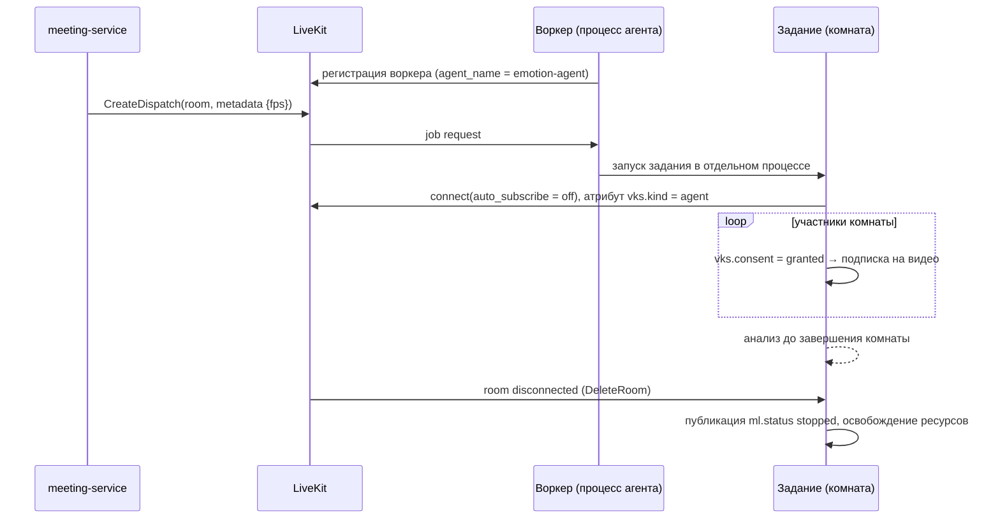
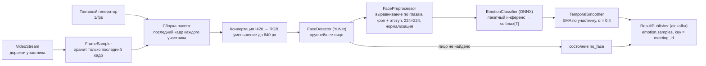

# emotion-ml-service

## Назначение

Сервис анализа: подключается к встрече как служебный участник LiveKit, получает видеодорожки участников, давших
согласие, распознает эмоции (7 классов) и публикует сглаженные результаты в шину событий (функция 6.5).
Не хранит состояния между встречами, не имеет БД и внешнего API (только `/health`, `/metrics`).

## Технологии ([ADR-007](../adr/ADR-007-ml-as-livekit-agent.md))

`livekit-agents` (Python), `livekit` (rtc), NumPy, OpenCV (детектор YuNet), ONNX Runtime (CPU/CUDA),
`aiokafka` (производитель, общий на процесс воркера), `vks_contracts`.

## Жизненный цикл задания



Каждая комната обрабатывается отдельным процессом задания (изоляция сбоев). Модели загружаются один раз в
процессе-«прогреве» воркера (`prewarm`) и разделяются через `fork`/повторную загрузку – решение уточняется на
спайке 2 по потреблению памяти.

## Конвейер обработки



- **Последний кадр выигрывает**: кадры между тактами отбрасываются, очередь не накапливается, поэтому задержка не
  растет при перегрузке, а снижается частота.
- **Адаптивная частота**: если время обработки такта > 80 % периода в течение 5 тактов, частота снижается на 1
  (не ниже `ML_MIN_FPS = 2`), при длительной перегрузке – `ml.status degraded`; при запасе > 50 % –
  частота возвращается к целевой.
- Инференс выполняется в пуле потоков (`asyncio.to_thread`), ONNX Runtime с `intra_op_num_threads` из конфигурации,
  чтобы не блокировать цикл событий, получающий кадры.
- Сглаживание сбрасывается при отзыве согласия, при потере лица > 3 с и при смене дорожки.

## Интерфейсы для замены компонентов

```python
class FaceDetector(Protocol):
    def detect(self, image: np.ndarray) -> list[FaceBox]: ...

class EmotionClassifier(Protocol):
    labels: tuple[str, ...]          # порядок классов из model_card.json
    input_size: tuple[int, int]
    def predict(self, faces: np.ndarray) -> np.ndarray: ...   # (N, 7) вероятности

class ResultSink(Protocol):
    async def publish(self, samples: list[EmotionSample]) -> None: ...
```

Модель подключается по `model_card.json` (архитектура, порядок классов, размер входа, mean/std, метрики, версия).
Новая модель = новый ONNX-файл + карточка, без изменения кода.

## Реакция на согласие

| Событие LiveKit | Действие |
|---|---|
| `participant_connected` / `track_published` (video, camera) | Если `vks.consent = granted` – подписка; иначе отсчет `state = no_consent` (один раз) |
| `participant_attributes_changed` (`vks.consent`) | granted → подписка; revoked/denied → немедленная отписка, сброс состояния, `state = no_consent` |
| `track_muted` (камера выключена) | `state = camera_off`, такты для участника пропускаются |
| `participant_disconnected` | Освобождение ресурсов участника |

Подписка только на дорожки источника `camera` (не `screen_share`), слой simulcast среднего качества (≈ 640×360) –
достаточен для лица и экономит декодирование.

## Публикуемые события

- `emotion.samples` – по одному на участника на такт (формат – [../api/events.md](../api/events.md)).
- `ml.status` – `active` при старте и каждые 5 с (heartbeat), `degraded`, `stopped`.

Публикация в Kafka – напрямую, без outbox: у сервиса нет БД, отсчеты эфемерны. Параметры производителя –
[conventions.md](../backend/conventions.md#6-публикация-событий-transactional-outbox) (`linger_ms=20`, `lz4`,
`request_timeout_ms=2000`). Отправка асинхронная и не блокирует такт анализа; если брокер недоступен, отсчеты
отбрасываются (буфер производителя ограничен), анализ продолжается, а после восстановления публикация возобновляется.

## Приватность

- Кадры существуют только как массивы в памяти одного такта; нет записи на диск, нет журналирования изображений.
- Флаг `ML_DEBUG_DUMP_FRAMES` существует только для локальной отладки на собственных видео команды; при
  `ENV=production` сервис отказывается стартовать с этим флагом.
- Эмбеддинги лиц не вычисляются и не сохраняются; идентификация – только по identity участника LiveKit.

## Производительность (оценка для CPU 4 ядра)

| Этап | На лицо | Пакет 10 лиц |
|---|---|---|
| Декодирование кадра 640×360 (libwebrtc) | ≈ 2 мс | – |
| YuNet 640×360 | ≈ 5–8 мс | ≈ 60 мс |
| Классификатор (MobileNetV3/EfficientNet-B0, 224², ONNX, FP32) | ≈ 8–15 мс | ≈ 60–100 мс |
| **Итого на такт** | | **≈ 130–180 мс** |

При 3 кадрах/с (период 333 мс) одна встреча из 10 участников занимает ≈ 1,5–2 ядра. Для 5 одновременных встреч
на рекомендуемом сервере – GPU или 2 реплики сервиса; на минимальном сервере (8 vCPU) – 1–2 встречи (соответствует
таблице 5 концепции). Цифры проверяются на нагрузочном тестировании.

## Метрики

`ml_tick_duration_seconds` (гистограмма), `ml_effective_fps{meeting}`, `ml_faces_detected_ratio`,
`ml_active_jobs`, `ml_inference_batch_size`, `ml_publish_errors_total`.

## Реализация и проверка

Код – [ml/emotion_service](../../ml/emotion_service/README.md). Соответствие проекта и кода:

| Элемент проекта | Реализация |
|---|---|
| FrameSampler, «последний кадр выигрывает» | `sampling.FrameSampler` – хранит сырой `rtc.VideoFrame`, конвертация в RGB только в такте |
| Адаптивная частота, `ML_MIN_FPS` | `sampling.AdaptiveRate` (80 % периода × 5 тактов → −1 кадр/с; 50 % × 10 → +1) |
| FaceDetector → FacePreprocessor → EmotionClassifier → TemporalSmoother | `pipeline.EmotionPipeline` (синхронный, вызывается через `asyncio.to_thread`) |
| Препроцессинг | `preprocessing.align_crop`: квадрат со стороной max(w, h) × 0,85 вокруг рамки YuNet, **48×48 серое** – как в обучении (калибровка – `ml/training/scripts/calibrate_crop.py`) |
| Реакция на согласие | `room.RoomAnalyzer` – таблица выше; подписка вручную (`AutoSubscribe.SUBSCRIBE_NONE`), средний слой simulcast |
| Формат сообщений | `events.emotion_sample`, `events.ml_status`, конверт `events.envelope` (UUIDv7), правило «no_consent / camera_off – при смене, no_face – ≤ 1 раз/с» – `events.StateThrottle` |
| Публикация | Порт `sinks.ResultSink`; сейчас `LoggingSink` (JSON в журнал), Kafka-производитель – с появлением `vks_contracts` |

### Проверка на локальном LiveKit (14.10.2026)

`livekit-server --dev` 1.13.10, `livekit-agents` 1.8.7, модель – базовая CNN v0.1.0, сценарий
`scripts/e2e_livekit.py` (два участника 640×360, 15 кадр/с; диспетчеризация с `{"fps": 3}`; отзыв согласия через
`UpdateParticipant` на 15-й секунде):

| Проверка | Результат |
|---|---|
| Агент входит в комнату по `CreateDispatch`, атрибут `vks.kind = agent` | Да |
| Подписка только на камеру участника с `vks.consent = granted` | Да; участнику с `denied` – один отсчет `no_consent`, подписки нет |
| Частота анализа | 41 отсчет за 13,5 с; `effective_fps` в `ml.status` – 2,96–3,16 при целевой 3 |
| Распознавание | Все 41 отсчет – `analyzing`, `dominant = happy` (на видео – лицо из класса happy теста FER-2013) |
| Отзыв согласия | Следующий же отсчет – `no_consent` (через 0,28 с после последнего `analyzing`), отписка, анализ прекращается |
| `ml.status` | `active` при старте и каждые 5 с, `stopped` при удалении комнаты |

Найдено при проверке: при загрузке CPU выше 0,7 (порог LiveKit Agents по умолчанию) воркер помечает себя занятым и
не получает задания – порог вынесен в `ML_LOAD_THRESHOLD`; для сервера, где ML-сервис – основная нагрузка, его
стоит поднять до 0,85–0,9 после нагрузочного теста.

### Сетка лица и внимание

Если доступна модель `face_landmarker.task` (`ML_FACE_MESH_MODEL`), конвейер дополнительно строит сетку MediaPipe
(478 точек) по области вокруг рамки YuNet ([landmarks.py](../../ml/emotion_service/src/emotion_service/landmarks.py)):

- **мимика** – 52 коэффициента; логистическая регрессия по ним (`blendshape_head.json` рядом с карточкой модели)
  смешивается с CNN (среднее геометрическое, вес 0,35 подобран на валидации), результаты – в
  [experiments.md](../../ml/training/experiments.md#7-путь-агента-калибровка-кропа-и-мимика-сетки-лица);
- **внимание** – 3D-поза головы и положение радужек → `attention` в событии `emotion.sample`
  ([attention.py](../../ml/emotion_service/src/emotion_service/attention.py)): заинтересован – смотрит в камеру
  ≈ 5 с, отвлечен – отвернулся, отвел взгляд или вышел из кадра ≈ 2,5 с. Без сетки – оценка по 5 точкам YuNet.

Цена – ≈ 20–35 мс CPU на лицо сверх ≈ 25 мс базового конвейера; при 10 участниках и 3 кадрах/с это ≈ 1
дополнительное ядро. Если CPU не хватает, сетку можно отключить (`ML_FACE_MESH_MODEL=`), анализ продолжится по
5 точкам.
