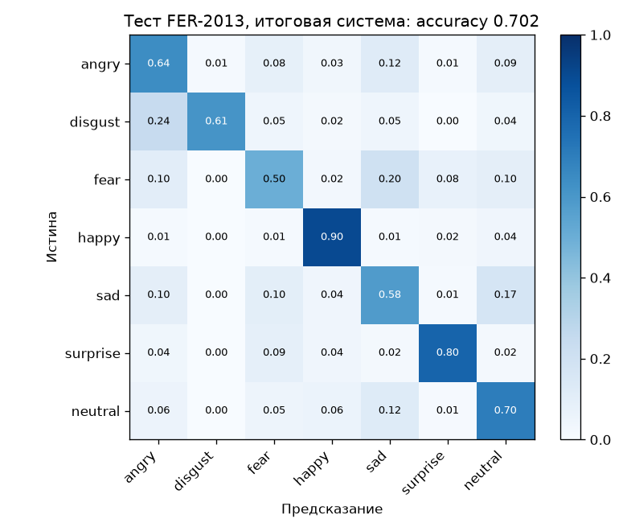

# Отчет о качестве модели распознавания эмоций (EMO-74)

Ответственный – Лесовой А. Е. Дата – 10.11.2026. Подробный журнал всех запусков –
[ml/training/experiments.md](../../ml/training/experiments.md); методика – [ml-model.md](ml-model.md).

## 1. Итог

| Критерий (ТЗ, устав) | Требование | Результат | Выполнен |
|---|---|---|---|
| Accuracy на тесте FER-2013 (PublicTest + PrivateTest, 7 178 изображений) | ≥ 65 % | **70,2 %** (итоговая система), 68,8 % (одна модель v1.0) | да |
| Время инференса модели на CPU | ≤ 15 мс/лицо | 4,5 мс/лицо (EfficientNet-B0, ONNX Runtime, 4 потока) | да |
| Частота анализа | 2–5 кадр/с | 3 кадр/с на встречу из 10 участников ([load-test.md](load-test.md)) | да |
| Отчет об обучении (accuracy, матрица ошибок) | есть | этот документ | да |
| Качество на собственной выборке команды | оценить | инструмент сбора и оценки готов, выборка не собрана (§7) | нет |

## 2. Данные и протокол

- Обучение – FER-2013 (28 709 изображений) после очистки: пустые кадры, 692 копии тестовых изображений
  (утечка), группы копий с противоречивыми метками; train 24 219 / val 2 692, стратифицировано, seed 42.
- Тест – FER-2013 PublicTest + PrivateTest без изменений; используется только для итоговых чисел. Модели,
  гиперпараметры, веса смешивания и пороги выбирались по валидации.
- Детектор очков и бороды – CelebA-attrs-20k (≈ 25 тыс. лиц с разметкой атрибутов). RAF-DB и AffectNet не
  получены (запросы – [datasets.md](datasets.md)).

## 3. Итоговая система

```
YuNet → кроп 48×48 → [без очков/бороды: ансамбль v1.0 + v1.1 | с очками/бородой: v1.1]
      → сетка лица → мимика (закрытые зоны отключены) → смешивание → калибровка (по запросу) → EMA
```

| Компонент | Версия | Обучение |
|---|---|---|
| Модель эмоций базовая | `emotion-efficientnetb0@1.0.0` | FER-2013, взвешенная CE, 15 эпох |
| Модель эмоций устойчивая | `emotion-efficientnetb0@1.1.0` | то же + синтетические очки и борода (p = 0,25 каждое) |
| Голова мимики | `blendshape_head.json` | логистическая регрессия по 52 коэффициентам MediaPipe |
| Очки / борода | `attributes-mobilenetv3@1.0.0` | CelebA-attrs-20k |

### 3.1 Тест FER-2013

| Вариант | Accuracy | Macro-F1 |
|---|---|---|
| Базовая CNN без предобучения | 0,686 | 0,659 |
| v1.0 (одна модель, как в сервисе – без отражения) | 0,688 | 0,668 |
| Маршрутизированная пара v1.0 + v1.1 | 0,699 | 0,676 |
| **Итоговая система** (+ мимика с учетом очков и бороды) | **0,702** | **0,685** |

### 3.2 По классам (итоговая система)

| Эмоция | Precision | Recall | F1 | Изображений |
|---|---|---|---|---|
| Радость | 0,881 | 0,899 | 0,890 | 1 774 |
| Удивление | 0,812 | 0,799 | 0,805 | 831 |
| Отвращение | 0,764 | 0,613 | 0,680 | 111 |
| Нейтральное | 0,638 | 0,702 | 0,668 | 1 233 |
| Гнев | 0,619 | 0,642 | 0,630 | 958 |
| Грусть | 0,582 | 0,581 | 0,582 | 1 247 |
| Страх | 0,584 | 0,496 | 0,536 | 1 024 |



Основные ошибки: страх → грусть (0,20), отвращение → гнев (0,24), грусть → нейтральное (0,17), нейтральное →
грусть (0,12). Радость и удивление распознаются надежно; страх, грусть и гнев – слабее всего, как и у моделей
из публикаций на FER-2013 (разметка этих классов на датасете наиболее шумная).

### 3.3 Пять групп для организатора (ADR-013)

| Группа | Классы | F1 |
|---|---|---|
| Радость | радость | 0,89 |
| Удивление | удивление | 0,81 |
| Нейтрально | нейтральное | 0,67 |
| Недовольство | гнев + отвращение | 0,67 |
| Напряжение | грусть + страх | 0,71 |
| **Итого** | | **accuracy 0,753, macro-F1 0,749** |

Согласие / несогласие (кивки, покачивания) и усталость (PERCLOS, зевки, опущенная голова) – правила по сетке
лица, проверены на синтетических последовательностях; проверка на живых записях – вместе с собственной выборкой.

## 4. Очки и борода

### 4.1 Детектор признаков (CelebA, тест 2 440 лиц)

| Признак | AUC | F1 | Precision | Recall | Accuracy |
|---|---|---|---|---|---|
| Очки | 0,999 | 0,923 | 0,906 | 0,941 | 0,990 |
| Борода / усы / эспаньолка | 0,969 | 0,790 | 0,786 | 0,795 | 0,925 |

### 4.2 Устойчивость модели эмоций (тест FER-2013 с синтетическими очками и бородой)

| Условие | v1.0 | v1.1 | **Итоговая система** |
|---|---|---|---|
| Без очков и бороды | 0,688 | 0,691 | **0,704** |
| Очки | 0,582 | 0,664 | **0,665** |
| Солнцезащитные очки | 0,568 | 0,646 | – |
| Борода | 0,510 | 0,640 | **0,641** |
| Щетина | 0,657 | 0,683 | – |
| Усы и эспаньолка | 0,606 | 0,657 | – |
| Очки + борода | 0,403 | 0,597 | **0,598** |
| Удивление (полнота) с бородой | 0,38 | 0,79 | 0,78 |

Синтетические наборы одинаковы для всех моделей (фиксированный seed). Настоящих лиц в очках и с бородой в тесте
FER-2013 мало (406 и 263 по детектору признаков), на них разница моделей в пределах погрешности. Как учитываются
признаки: устойчивая модель для лиц с очками/бородой, отключение мимических коэффициентов закрытой зоны (очки –
брови и глаза, борода – рот, челюсть, щеки), отдельный вес мимики для каждого условия (0,3 / 0,2 / 0,3 / 0,3).

## 5. Экспорт, квантизация, задержка (EMO-75)

| Вариант | Accuracy | Совпадение с FP32 | CPU, мс/лицо (1 / пакет 10) | Размер |
|---|---|---|---|---|
| ONNX FP32 | 0,688 | 1,000 | 4,5 / 4,9 | 15,3 МБ |
| INT8 статическая, калибровка MinMax | 0,520 | 0,583 | 9,0 / 4,8 * | 4,7 МБ |
| INT8 статическая, перцентиль 99,99 | 0,640 | 0,785 | 4,7 / 3,8 | 4,7 МБ |
| INT8 статическая, энтропия | 0,557 | 0,629 | 4,7 / 4,1 | 4,7 МБ |
| PyTorch, GPU RTX 5060 Laptop (bf16) | – | – | 6,2 / 0,7 | – |

\* замер при параллельной нагрузке. Отклонение ONNX от PyTorch – 6·10⁻⁶ (порог 10⁻³). **INT8 не принята**: потеря
4,8 п. п. и больше при критерии ≤ 1 п. п., а FP32 уже укладывается в 15 мс/лицо. EfficientNet (SiLU,
поглубинные свертки) плохо переносит статическую квантизацию без дообучения с учетом квантизации (QAT).

## 6. Путь агента и калибровка

- **Кроп лица**: прежний кроп агента (× 1,1, поворот) давал на валидации 0,640 против 0,685 на исходных
  изображениях; откалиброванный (× 0,85, без поворота) – 0,688 (полнота «удивления» 0,65 → 0,75).
- **Калибровка под человека**: на FER-2013 модель «грусть» не завышает (17,3 % предсказаний при 17,4 % в
  разметке), но у конкретного человека в покое – часто; 3 с нейтрального лица задают личную базу.

## 7. Собственная выборка (EMO-92)

Готовы: запись размеченных кадров в живой демонстрации (`scripts/live_demo.py` → «Сбор выборки»: эмоция +
«Записать 3 с»; сохраняются только кроп 48×48, мимика и признаки) и оценка `ml/training/scripts/eval_own.py`
(accuracy, macro-F1, по классам, по условиям очки/борода, по записям). **Выборка не собрана** – нужны записи
участников с их согласия; ожидаемо точность на живых лицах ниже, чем на FER-2013 (слабые выражения, другие
условия съемки).

## 8. Ограничения

- Модель видит выражение лица, а не чувства; результаты вероятностные и не подходят для решений о людях.
- Обучение – только FER-2013 (48×48, преувеличенные выражения); без RAF-DB / AffectNet переход на живое видео
  остается главным риском качества.
- Очки и борода в обучении синтетические: настоящие оправы, блики и густые бороды разнообразнее.
- Лицензии FER-2013 и CelebA – только некоммерческое учебное использование.
