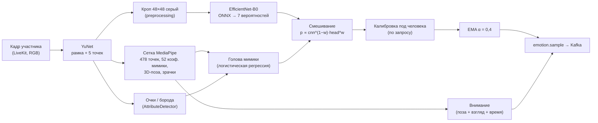

# Руководство программиста: ML-модуль

Раздел руководства программиста ReactiVKS (EMO-113). Архитектура Системы – [docs/architecture](../architecture/),
контракты – [docs/api](../api/). Здесь – как устроены, обучаются, проверяются и выпускаются модели распознавания
эмоций и как с ними работает emotion-ml-service.

## 1. Состав

| Каталог | Что внутри |
|---|---|
| `ml/emotion_service` | Сервис-агент LiveKit: конвейер распознавания, события Kafka, живая демонстрация |
| `ml/training` | Обучение и оценка: пакет `fer_training`, конфигурации, скрипты, журнал экспериментов |
| `ml/models` | Карточки моделей (`*card.json`), голова мимики; сами веса – Releases / `fetch_models.sh` |
| `docs/ml` | Модель, сервис, датасеты, детекторы, отчет о качестве, этот раздел |

## 2. Конвейер одного такта



| Модуль (`emotion_service`) | Ответственность | Порт / класс |
|---|---|---|
| `detection.py` | Лицо и 5 точек | `FaceDetector` / `YuNetDetector` |
| `preprocessing.py` | Канонический кроп (общий с обучением) | `align_crop`, `PREPROCESSING_ID` |
| `classifier.py` | ONNX-классификатор по карточке | `EmotionClassifier` / `OnnxEmotionClassifier` |
| `landmarks.py` | Сетка, мимика, поза, взгляд | `FaceMeshAnalyzer` |
| `attributes.py` | Очки и борода | `AttributeDetector` |
| `fusion.py` | Смешивание CNN и мимики, учет закрытых зон | `BlendshapeHead.fuse_with_attributes` |
| `calibration.py` | Личная нейтральная база | `NeutralCalibrator` |
| `smoothing.py`, `attention.py` | Сглаживание, внимание | `TemporalSmoother`, `AttentionTracker` |
| `pipeline.py` | Такт целиком, без ввода-вывода | `EmotionPipeline.process` |
| `sampling.py` | Последний кадр, адаптивная частота | `FrameSampler`, `AdaptiveRate` |
| `room.py`, `agent.py` | LiveKit: согласие, подписки, такты | `RoomAnalyzer`, `entrypoint` |
| `events.py`, `sinks.py` | Контракт `vks_contracts`, Kafka | `emotion_sample`, `KafkaSink` |

Любой компонент заменяется через свой порт (Protocol) без правки конвейера. Новая модель эмоций – новый ONNX и
`model_card.json`: сервис проверяет порядок классов и идентификатор препроцессинга и откажется стартовать при
расхождении.

## 3. Модели

| Модель | Файл | Вход | Обучение | Качество |
|---|---|---|---|---|
| Эмоции, базовая (EfficientNet-B0 v1.0) | `models/emotion/emotion-efficientnetb0-v1.0.0.onnx` | (N, 1, 48, 48) float 0..1 | `fer-train train` | [model-report.md](model-report.md) |
| Эмоции, устойчивая к очкам и бороде (v1.1) | `models/emotion-robust/emotion-efficientnetb0-v1.1.0.onnx` | то же | `fer-train train … augment.occlusion=0.25` | там же, §4 |
| Голова мимики | `models/emotion/blendshape_head.json` | 52 коэффициента | `scripts/train_blendshape_head.py` | там же, §3 |
| Очки / борода (MobileNetV3) | `models/attributes/attributes-*.onnx` | (N, 96, 96, 3) uint8 RGB | `scripts/train_attributes.py` | там же, §4 |
| Детектор лиц YuNet | `models/yunet/*.onnx` | кадр BGR | готовая (OpenCV Zoo) | [face-detector.md](face-detector.md) |
| Сетка лица | `models/mediapipe/face_landmarker.task` | кадр RGB | готовая (Google) | – |

## 4. Обучение модели эмоций

```bash
cd ml/training
uv sync                                   # PyTorch CUDA 12.8 (RTX 50xx), timm, albumentations
# данные: data/README.md (FER-2013, 3 файла parquet)
uv run fer-train prepare                  # кеш 48×48 + распределение классов
uv run python scripts/fer_landmarks.py    # 5 точек YuNet – для синтетических очков и бороды
uv run fer-train train --config configs/finetune.yaml model.arch=efficientnet_b0 train.balance=weighted_loss \
    augment.occlusion=0.25 name=v1-1
```

- Конфигурация – YAML (`configs/`) + переопределения `ключ=значение`; полный протокол запуска сохраняется в
  `runs/<name>/<время>/` (конфигурация, история эпох, лучшие веса, метрики, матрицы ошибок).
- Данные: FER-2013 очищается от пустых кадров, утечки train ↔ test и копий с противоречивыми метками
  (`data.dedup`); разбиение train/val стратифицировано, seed 42; тест – PublicTest + PrivateTest без изменений.
- Аугментации: геометрия, свет, размытие, сжатие VP8/H.264, окклюзии (`augment.level=vks`), синтетические очки и
  борода (`augment.occlusion`, [fer_training/occlusions.py](../../ml/training/src/fer_training/occlusions.py)).
- Выбор эпохи и гиперпараметров – только по валидации; тест – для итоговых чисел
  ([experiments.md](../../ml/training/experiments.md)).

## 5. Проверка и выпуск

```bash
uv run fer-train export --checkpoint runs/…/best.pt --version 1.1.0 --out ../models/emotion   # ONNX + карточка
uv run fer-train bench --onnx ../models/emotion/emotion-*.onnx                                # CPU, мс/лицо
uv run fer-train bench-gpu --checkpoint runs/…/best.pt                                         # GPU, мс/лицо
uv run python scripts/train_blendshape_head.py --card ../models/emotion/model_card.json        # голова мимики
uv run python scripts/eval_occlusion.py --card ../models/emotion/model_card.json               # очки / борода
uv run python scripts/calibrate_crop.py --card ../models/emotion/model_card.json               # кроп агента
uv run python scripts/eval_own.py --card ../models/emotion/model_card.json                     # своя выборка
```

Критерии выпуска: accuracy ≥ 65 % на тесте FER-2013, ≤ 15 мс/лицо на CPU, отклонение ONNX от PyTorch < 1e-3,
устойчивость к очкам и бороде не хуже предыдущей версии. Веса публикуются в GitHub Releases; в репозитории –
карточки. Версия модели попадает в каждое событие `emotion.sample` (`model_version`).

## 6. Сервис: запуск и настройка

| Переменная | По умолчанию | Назначение |
|---|---|---|
| `LIVEKIT_URL`, `LIVEKIT_API_KEY`, `LIVEKIT_API_SECRET` | – | Подключение воркера к LiveKit |
| `ML_KAFKA_BOOTSTRAP` | пусто – журнал | Kafka для `emotion.samples` и `ml.status` |
| `ML_MODEL_CARD`, `ML_DETECTOR_MODEL`, `ML_FACE_MESH_MODEL`, `ML_ATTRIBUTES_CARD` | `../models/…` | Модели; без сетки или детектора признаков сервис работает в упрощенном режиме |
| `ML_TARGET_FPS` / `ML_MIN_FPS` / `ML_MAX_FPS` | 3 / 2 / 5 | Частота анализа (целевая – из диспетчеризации) |
| `ML_ROBUST_MODEL_CARD` | `../models/emotion-robust/…` | Устойчивая модель; есть – маршрутизация по очкам и бороде |
| `ML_ONNX_THREADS` / `ML_FACE_WORKERS` | 4 / 4 | Потоки ONNX Runtime на модель / потоки обработки лиц такта |
| `ML_IDLE_PROCESSES` | 1 | Прогретые процессы заданий (процесс на встречу, ≈ 1,3 ГБ) |
| `ML_LOAD_THRESHOLD` | 0,7 | Загрузка CPU, выше которой воркер не берет новые встречи |
| `ML_AUTO_NEUTRAL_S` | 5 | Автокалибровка: N секунд спокойного лица (без улыбки, открытого рта, движения бровей, голова к камере); 0 – выключена |

Контейнер: `ml/emotion_service/Dockerfile` (контекст – корень репозитория), сервис `emotion-ml-service` в
`deploy/docker-compose.yml`, модели монтируются в `/models`. Локально: `uv run emotion-agent start`; проверка
на живом LiveKit – `scripts/e2e_livekit.py`, нагрузка – `scripts/load_test.py`
([load-test.md](load-test.md)), демонстрация на веб-камере – `scripts/live_demo.py`.

## 7. Тесты и качество кода

```bash
cd ml/emotion_service && uv run pytest && uv run ruff check . && uv run mypy src
cd ml/training && uv run pytest && uv run ruff check .
cd backend && uv run pytest libs/vks_contracts      # контракт событий, снимок схемы
```

Изменение формата события – правка `backend/libs/vks_contracts`, снимок `events.schema.json`
(`vks-contracts-schema`) и `docs/api/events.md` в одном изменении.

## 8. Ограничения

- Модель обучена на FER-2013 (48×48, преувеличенные выражения): на живом видео точность ниже, слабые выражения
  распознаются хуже; спокойное лицо может смещаться к «грусти» – калибровка под человека.
- Очки и борода учитываются, но точность для таких лиц ниже; солнцезащитные очки и густая борода – самый сложный
  случай ([model-report.md](model-report.md), §4).
- Внимание – по позе головы и положению зрачков, не по направлению взгляда в пространстве.
- Датасеты FER-2013, CelebA – только некоммерческое учебное использование ([datasets.md](datasets.md)).
